# Second-transit shortlist

Candidates in: 116. TICs with S>=61 light curves: 102 of 112. Events passing cuts: 56. TICs that tess-point says were observed in S61-S107 with no light curve on MAST yet: 12 (see pointed_no_lc_ge61 in coverage.csv, which also lists scheduled sectors; these need FFI extraction, e.g. TESSCut).

Cuts: SNR >= 7.0, depth ratio 0.5-2.0, duration ratio 0.5-2.0, SNR >= 1.5 x strongest brightening.

## TIC 143355733 (paper T1 2053.8367, new T2 4178.9164, S104 QLP)
Depth 15995 +/- 276 ppm vs 8162 ppm; duration 6.39 h vs 5.07 h (box fits; paper CNN: 9182 ppm, 5.70 h); SNR 58.0. dT = 2125.08 d, so P <= 2125.08 d. Aliases: 36 allowed, 2089 excluded by data, 0 below the circular-orbit minimum (6.4 d). Longest allowed 2125.08 d.
Notes: event 0.05 d from a gap or sector edge, check systematics; only 70% of the transit window has data; also passes: S104 T=4179.0750 SNR 50.9, depth ratio 1.15, duration ratio 2.00 (near edge); also passes: S94 T=3856.5312 SNR 50.4, depth ratio 1.86, duration ratio 1.12 (near edge); also passes: S94 T=3869.6699 SNR 26.7, depth ratio 0.77, duration ratio 1.78 (near edge); also passes: S94 T=3869.7386 SNR 24.4, depth ratio 0.63, duration ratio 2.00 (near edge); also passes: S104 T=4198.3761 SNR 21.8, depth ratio 0.74, duration ratio 0.89; also passes: S67 T=3146.3427 SNR 20.1, depth ratio 0.96, duration ratio 1.00
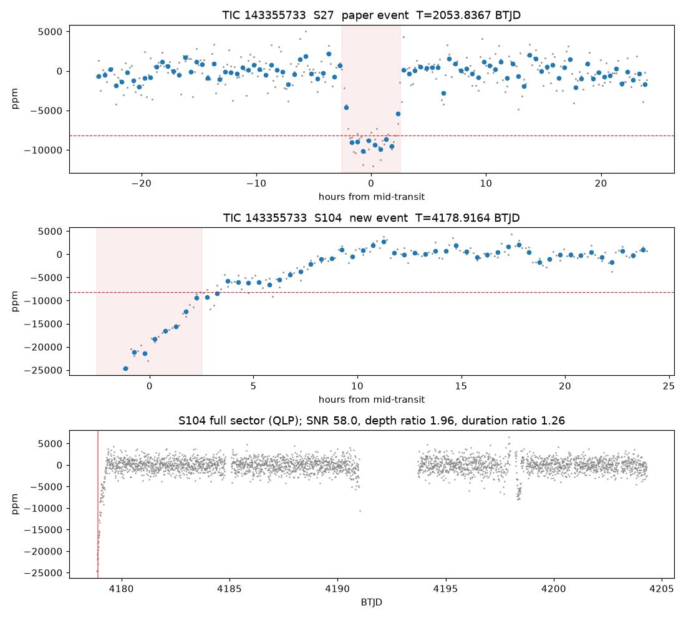

## TIC 325017283 (paper T1 2045.9052, new T2 4112.8045, S101 QLP)
Depth 8641 +/- 206 ppm vs 4645 ppm; duration 7.56 h vs 4.24 h (box fits; paper CNN: 5581 ppm, 5.34 h); SNR 42.0. dT = 2066.90 d, so P <= 2066.90 d. Aliases: 17 allowed, 2049 excluded by data, 0 below the circular-orbit minimum (0.4 d). Longest allowed 2066.90 d.
Notes: event 0.11 d from a gap or sector edge, check systematics; also passes: S102 T=4140.1591 SNR 34.4, depth ratio 1.71, duration ratio 1.59 (near edge, 79% covered); also passes: S102 T=4140.2474 SNR 30.6, depth ratio 1.28, duration ratio 2.00 (near edge); also passes: S102 T=4142.1469 SNR 21.5, depth ratio 1.19, duration ratio 1.00; also passes: S103 T=4166.4708 SNR 19.7, depth ratio 0.86, duration ratio 1.41 (near edge); also passes: S94 T=3866.8884 SNR 18.2, depth ratio 1.14, duration ratio 0.79; also passes: S101 T=4120.9635 SNR 17.3, depth ratio 1.12, duration ratio 0.79; also passes: S93 T=3845.7153 SNR 16.3, depth ratio 1.06, duration ratio 1.00; also passes: S100 T=4078.6232 SNR 16.0, depth ratio 0.81, duration ratio 1.12; also passes: S66 T=3104.6086 SNR 14.4, depth ratio 1.18, duration ratio 0.79; also passes: S93 T=3854.8196 SNR 13.9, depth ratio 0.69, duration ratio 2.00 (near edge); also passes: S67 T=3146.9655 SNR 13.8, depth ratio 1.35, duration ratio 0.56; also passes: S100 T=4074.4134 SNR 10.0, depth ratio 0.57, duration ratio 1.41 (near edge, 56% covered)
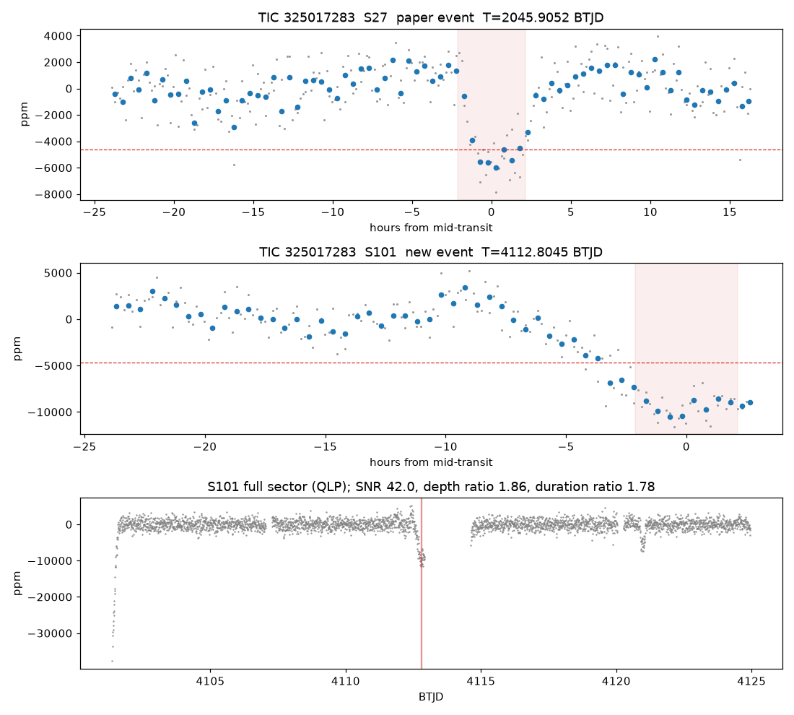

## TIC 141423461 (paper T1 2277.4415, new T2 3663.1338, S87 QLP)
Depth 18576 +/- 484 ppm vs 12210 ppm; duration 16.48 h vs 8.24 h (box fits; paper CNN: 12800 ppm, 9.25 h); SNR 38.4. dT = 1385.69 d, so P <= 1385.69 d. Aliases: 1 allowed, 1384 excluded by data, 0 below the circular-orbit minimum (18.0 d). Longest allowed 1385.69 d.
Notes: event 0.02 d from a gap or sector edge, check systematics; only 53% of the transit window has data; also passes: S98 T=4017.7277 SNR 15.9, depth ratio 0.56, duration ratio 0.56 (near edge, 58% covered); also passes: S67 T=3126.6661 SNR 14.5, depth ratio 0.85, duration ratio 0.63 (near edge, 51% covered)
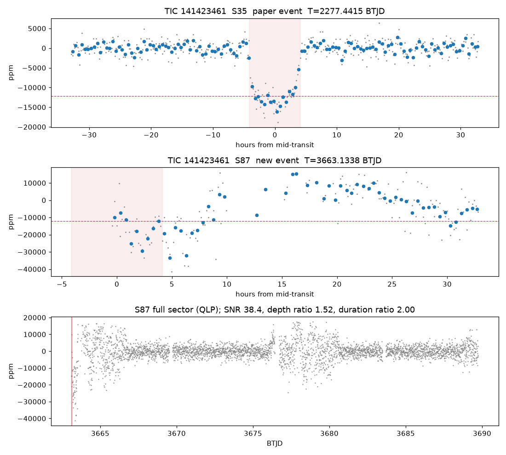

## TIC 241550976 (paper T1 2339.4447, new T2 4141.1858, S102 QLP)
Depth 13870 +/- 374 ppm vs 16550 ppm; duration 3.26 h vs 4.61 h (box fits; paper CNN: 18366 ppm, 5.81 h); SNR 37.1. dT = 1801.74 d, so P <= 1801.74 d. Aliases: 14 allowed, 1786 excluded by data, 0 below the circular-orbit minimum (14.6 d). Longest allowed 1801.74 d. Possible third transit at P = 105.9848 d.
Notes: event 0.43 d from a gap or sector edge, check systematics; also passes: S100 T=4077.5872 SNR 32.3, depth ratio 0.82, duration ratio 0.89; also passes: S101 T=4120.0068 SNR 31.4, depth ratio 0.74, duration ratio 1.26 (63% covered); also passes: S65 T=3081.3349 SNR 29.1, depth ratio 1.06, duration ratio 0.71; also passes: S64 T=3060.1451 SNR 28.8, depth ratio 0.86, duration ratio 0.89
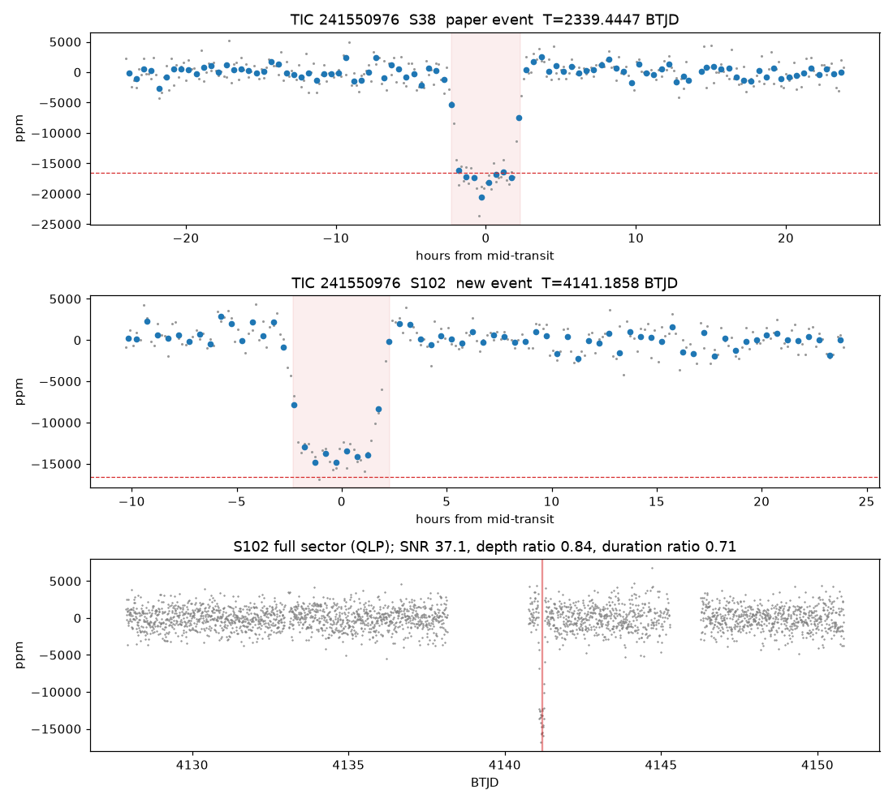

## TIC 373876456 (paper T1 2861.9830, new T2 3593.5017, S84 TESS-SPOC)
Depth 3654 +/- 101 ppm vs 4232 ppm; duration 12.99 h vs 10.31 h (box fits; paper CNN: 4610 ppm, 11.57 h); SNR 36.3. dT = 731.52 d, so P <= 731.52 d. Aliases: 19 allowed, 712 excluded by data, 0 below the circular-orbit minimum (28.1 d). Longest allowed 731.52 d.
Notes: none flagged.
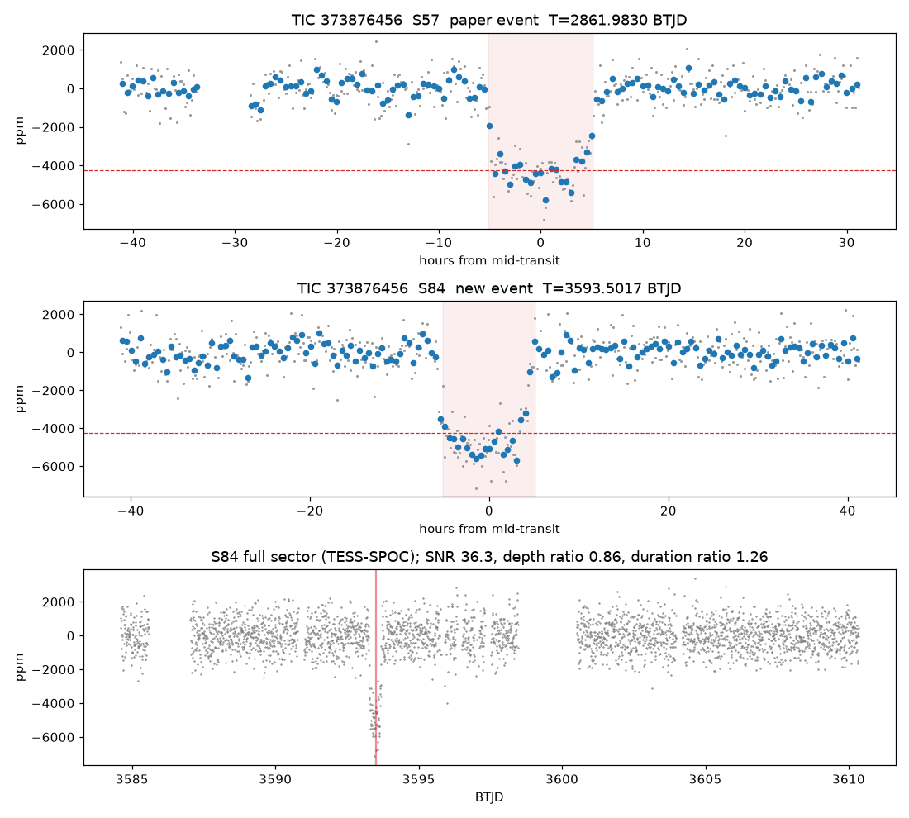

## TIC 275647095 (paper T1 2315.5171, new T2 4124.2963, S101 QLP)
Depth 8551 +/- 239 ppm vs 9272 ppm; duration 6.75 h vs 7.57 h (box fits; paper CNN: 10298 ppm, 8.50 h); SNR 35.8. dT = 1808.78 d, so P <= 1808.78 d. Aliases: 18 allowed, 1790 excluded by data, 0 below the circular-orbit minimum (34.9 d). Longest allowed 1808.78 d.
Notes: also passes: S100 T=4090.1616 SNR 30.9, depth ratio 0.84, duration ratio 0.89; also passes: S64 T=3049.2589 SNR 26.5, depth ratio 1.05, duration ratio 0.89; also passes: S90 T=3748.8909 SNR 22.4, depth ratio 0.89, duration ratio 1.00; also passes: S101 T=4107.2795 SNR 20.6, depth ratio 0.79, duration ratio 0.79 (53% covered); also passes: S90 T=3765.9550 SNR 20.3, depth ratio 0.80, duration ratio 1.00; also passes: S64 T=3066.3309 SNR 18.2, depth ratio 0.72, duration ratio 0.89
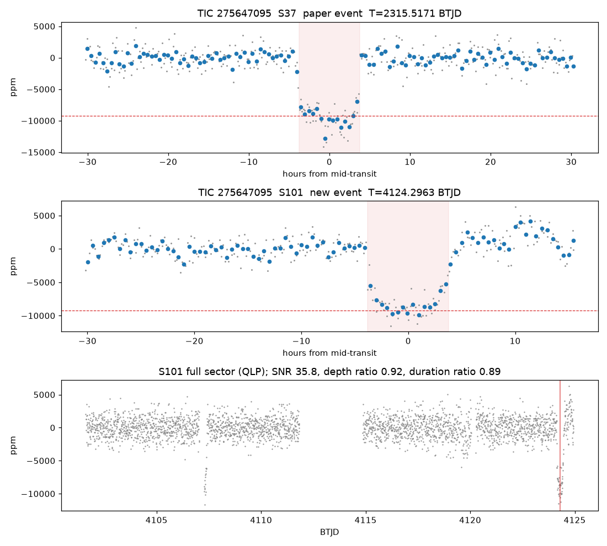

## TIC 317132251 (paper T1 2221.7784, new T2 4289.0194, S107 SPOC)
Depth 2555 +/- 72 ppm vs 3641 ppm; duration 13.51 h vs 6.76 h (box fits; paper CNN: 4235 ppm, 7.58 h); SNR 35.4. dT = 2067.24 d, so P <= 2067.24 d. Aliases: 20 allowed, 2047 excluded by data, 0 below the circular-orbit minimum (14.8 d). Longest allowed 2067.24 d.
Notes: already TOI 7717.01 (P=25.2087, same signal: yes, disp PC); already CTOI 317132251.01 (P=); also passes: S98 T=4036.7964 SNR 31.0, depth ratio 1.29, duration ratio 0.89; also passes: S98 T=4011.5892 SNR 30.1, depth ratio 1.25, duration ratio 0.89
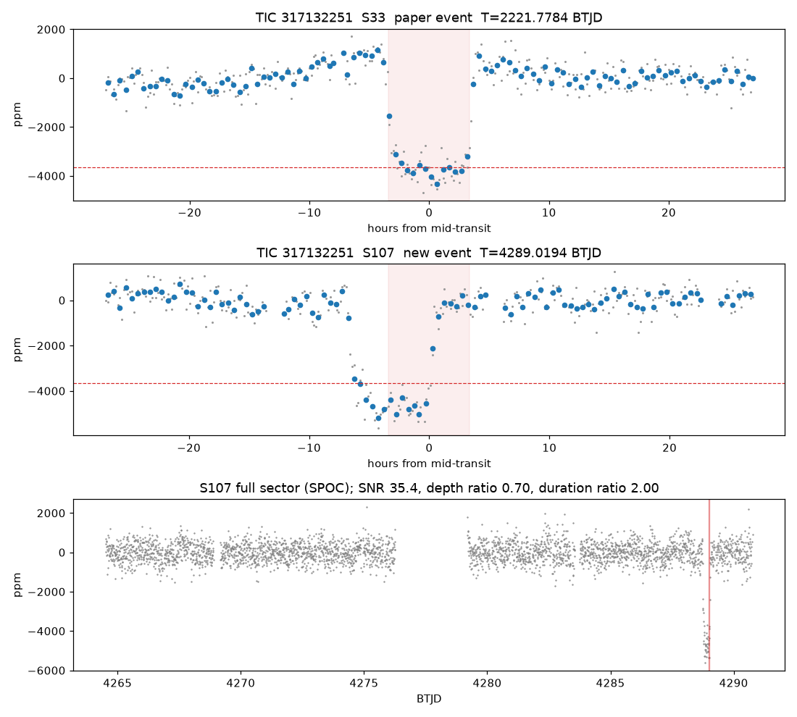

## TIC 152464302 (paper T1 2284.8407, new T2 4066.3473, S99 QLP)
Depth 6878 +/- 208 ppm vs 5819 ppm; duration 5.86 h vs 10.44 h (box fits; paper CNN: 9136 ppm, 8.29 h); SNR 33.0. dT = 1781.51 d, so P <= 1781.51 d. Aliases: 19 allowed, 1753 excluded by data, 5 below the circular-orbit minimum (59.8 d). Longest allowed 1781.51 d. Possible third transit at P = 296.9178;98.9726;59.3836;26.9925 d.
Notes: also passes: S90 T=3769.4219 SNR 25.6, depth ratio 1.44, duration ratio 0.50
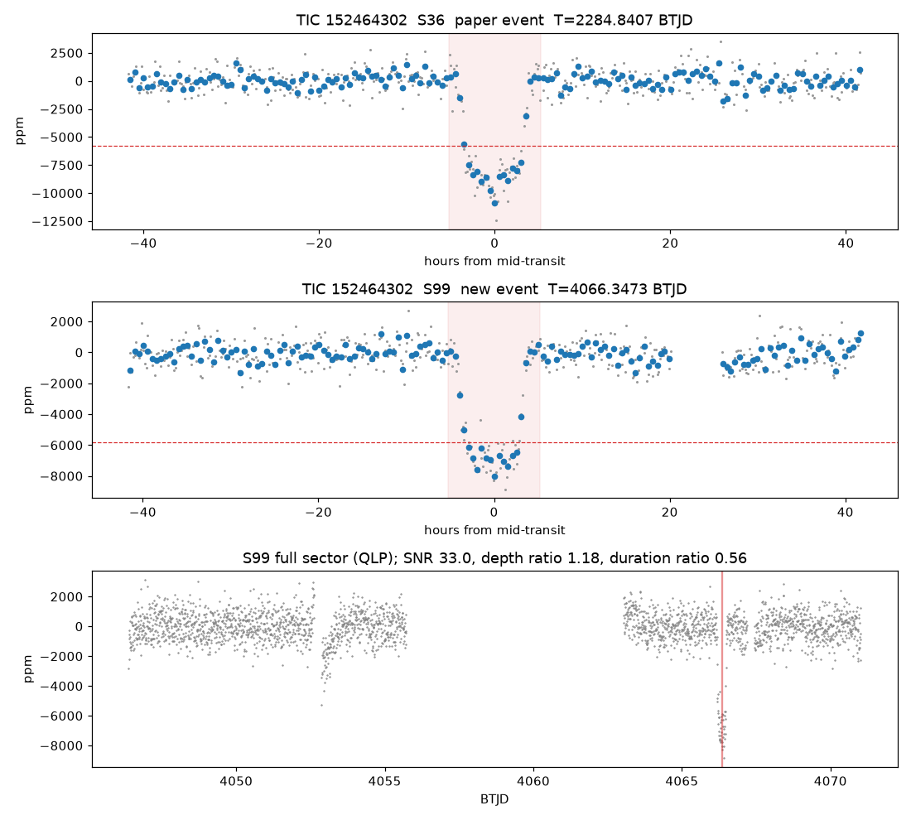

## TIC 266643424 (paper T1 2069.3627, new T2 3899.7442, S95 QLP)
Depth 1523 +/- 54 ppm vs 1010 ppm; duration 9.68 h vs 4.84 h (box fits; paper CNN: 1610 ppm, 5.43 h); SNR 28.3. dT = 1830.38 d, so P <= 1830.38 d. Aliases: 58 allowed, 1772 excluded by data, 0 below the circular-orbit minimum (2.9 d). Longest allowed 1830.38 d.
Notes: event 0.19 d from a gap or sector edge, check systematics; only 60% of the transit window has data; also passes: S95 T=3899.7140 SNR 28.0, depth ratio 1.43, duration ratio 2.00 (near edge, 65% covered); also passes: S95 T=3906.5823 SNR 22.2, depth ratio 1.11, duration ratio 2.00 (near edge, 69% covered)
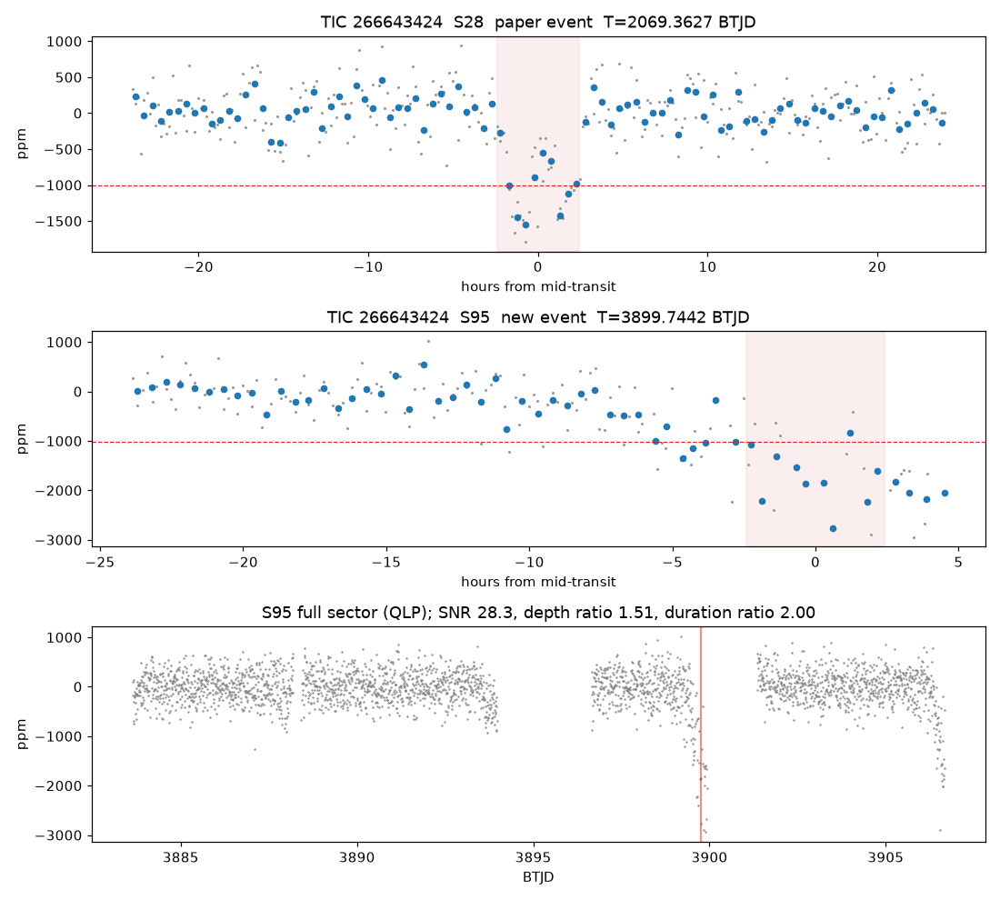

## TIC 438588300 (paper T1 2309.1656, new T2 4104.7834, S101 QLP)
Depth 2499 +/- 93 ppm vs 2521 ppm; duration 8.26 h vs 7.36 h (box fits; paper CNN: 3039 ppm, 9.27 h); SNR 26.8. dT = 1795.62 d, so P <= 1795.62 d. Aliases: 30 allowed, 1765 excluded by data, 0 below the circular-orbit minimum (26.9 d). Longest allowed 1795.62 d.
Notes: none flagged.
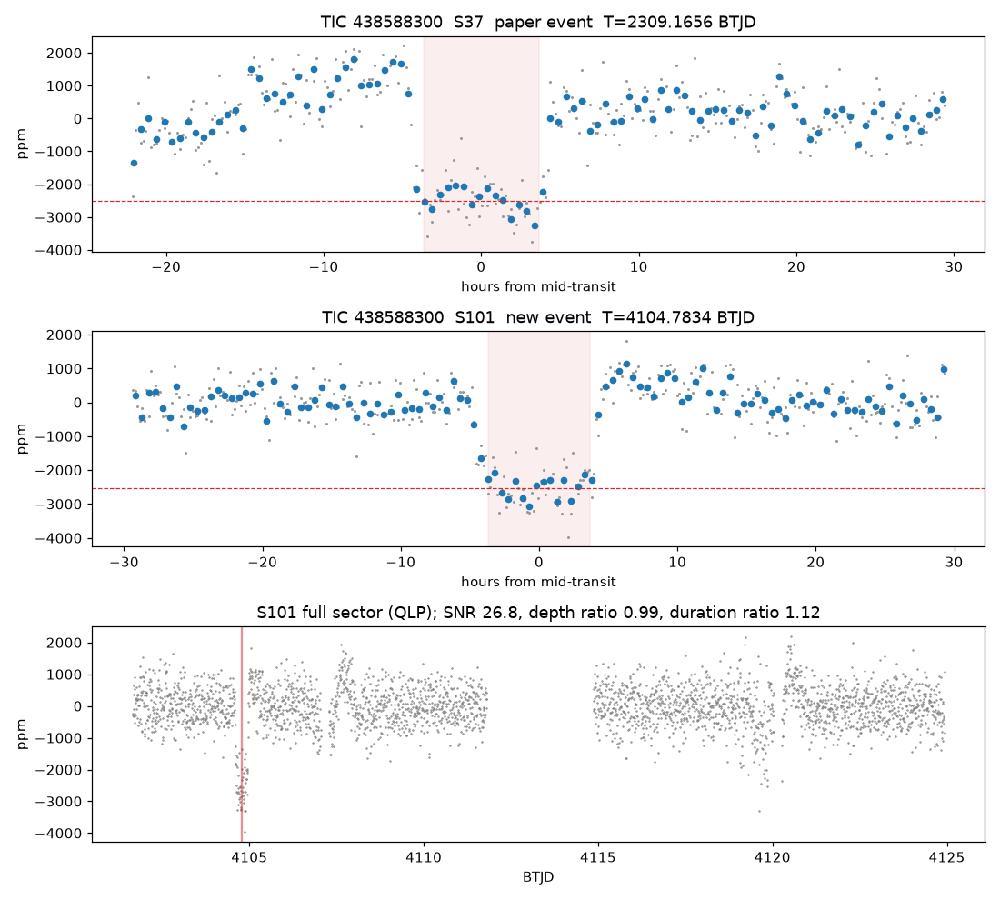

## TIC 402324434 (paper T1 2097.4026, new T2 3932.8347, S96 QLP)
Depth 1502 +/- 56 ppm vs 800 ppm; duration 6.47 h vs 3.23 h (box fits; paper CNN: 909 ppm, 3.63 h); SNR 26.6. dT = 1835.43 d, so P <= 1835.43 d. Aliases: 27 allowed, 1808 excluded by data, 0 below the circular-orbit minimum (1.2 d). Longest allowed 1835.43 d.
Notes: event 0.11 d from a gap or sector edge, check systematics; only 77% of the transit window has data; also passes: S96 T=3932.6763 SNR 24.9, depth ratio 1.58, duration ratio 2.00 (near edge); also passes: S96 T=3926.0247 SNR 21.8, depth ratio 1.52, duration ratio 1.78
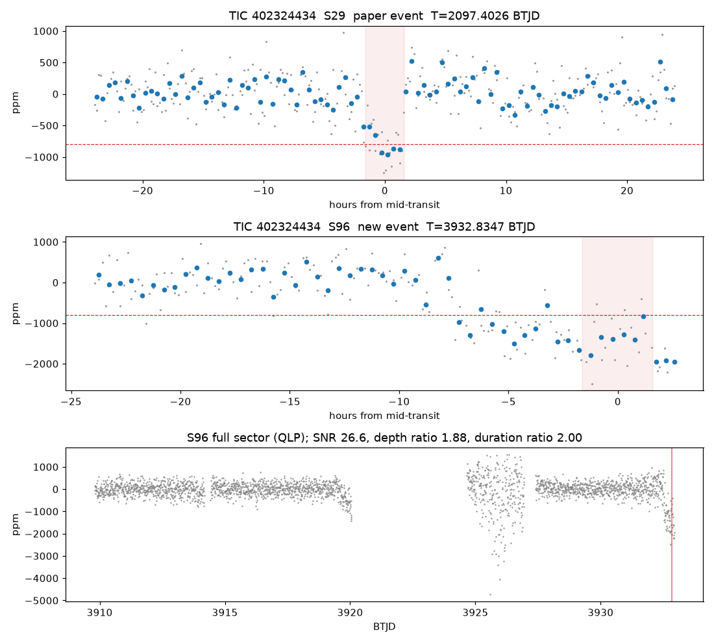

## TIC 290596728 (paper T1 2044.2104, new T2 3880.8866, S94 QLP)
Depth 3040 +/- 115 ppm vs 2479 ppm; duration 9.15 h vs 9.15 h (box fits; paper CNN: 3633 ppm, 8.15 h); SNR 26.3. dT = 1836.68 d, so P <= 1836.68 d. Aliases: 10 allowed, 1808 excluded by data, 18 below the circular-orbit minimum (133.8 d). Longest allowed 1836.68 d.
Notes: already CTOI 290596728.01 (P=); event 0.05 d from a gap or sector edge, check systematics; only 53% of the transit window has data; also passes: S94 T=3856.6609 SNR 18.2, depth ratio 0.58, duration ratio 1.26 (near edge)
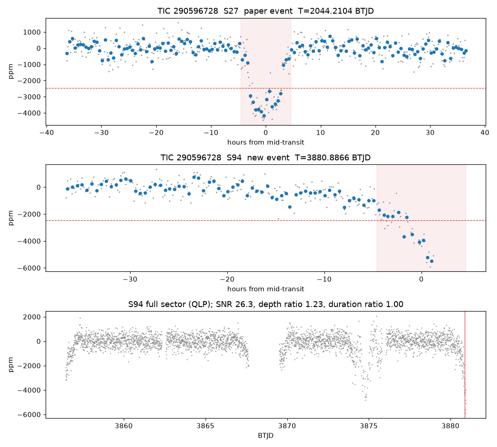

## TIC 230133616 (paper T1 2396.1307, new T2 3607.5333, S84 TESS-SPOC)
Depth 5588 +/- 218 ppm vs 5296 ppm; duration 8.19 h vs 8.19 h (box fits; paper CNN: 5703 ppm, 9.20 h); SNR 25.6. dT = 1211.40 d, so P <= 1211.40 d. Aliases: 3 allowed, 1207 excluded by data, 0 below the circular-orbit minimum (5.3 d). Longest allowed 1211.40 d. Possible third transit at P = 71.2590 d.
Notes: also passes: S82 T=3536.2739 SNR 21.7, depth ratio 0.95, duration ratio 1.12; also passes: S81 T=3512.4975 SNR 20.8, depth ratio 0.97, duration ratio 0.79; also passes: S78 T=3441.2571 SNR 20.3, depth ratio 0.93, duration ratio 1.00; also passes: S74 T=3322.5044 SNR 18.0, depth ratio 0.99, duration ratio 0.79; also passes: S79 T=3465.0043 SNR 17.2, depth ratio 0.88, duration ratio 0.79; also passes: S83 T=3560.0223 SNR 15.2, depth ratio 0.62, duration ratio 1.12; also passes: S73 T=3298.7482 SNR 14.6, depth ratio 0.64, duration ratio 1.00; also passes: S83 T=3583.7811 SNR 14.3, depth ratio 0.65, duration ratio 1.00; also passes: S76 T=3393.7757 SNR 11.9, depth ratio 0.84, duration ratio 1.26; also passes: S86 T=3655.0571 SNR 10.1, depth ratio 0.86, duration ratio 1.00; also passes: S77 T=3417.5089 SNR 8.5, depth ratio 0.80, duration ratio 1.12 (near edge)
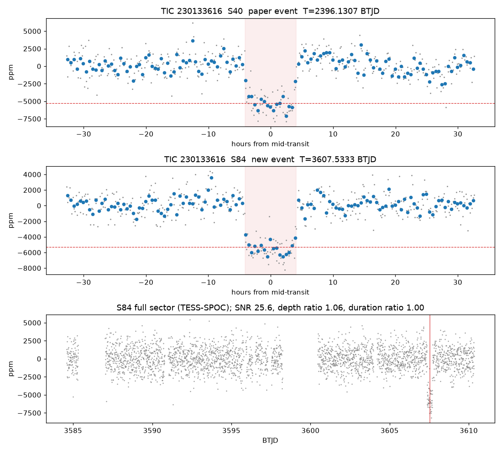

## TIC 156068960 (paper T1 2062.6379, new T2 4164.3899, S103 QLP)
Depth 15306 +/- 619 ppm vs 8876 ppm; duration 2.61 h vs 5.21 h (box fits; paper CNN: 9870 ppm, 6.57 h); SNR 24.7. dT = 2101.75 d, so P <= 2101.75 d. Aliases: 22 allowed, 2079 excluded by data, 0 below the circular-orbit minimum (19.2 d). Longest allowed 2101.75 d.
Notes: event 0.00 d from a gap or sector edge, check systematics; only 51% of the transit window has data; also passes: S104 T=4184.1931 SNR 24.6, depth ratio 0.88, duration ratio 1.12; also passes: S104 T=4179.3703 SNR 22.6, depth ratio 0.81, duration ratio 1.78 (near edge, 56% covered); also passes: S103 T=4166.5950 SNR 18.1, depth ratio 0.68, duration ratio 1.00 (near edge, 77% covered); also passes: S103 T=4153.6256 SNR 14.8, depth ratio 0.54, duration ratio 1.00 (near edge, 80% covered); also passes: S96 T=3920.4279 SNR 13.2, depth ratio 0.60, duration ratio 0.89 (near edge, 68% covered)
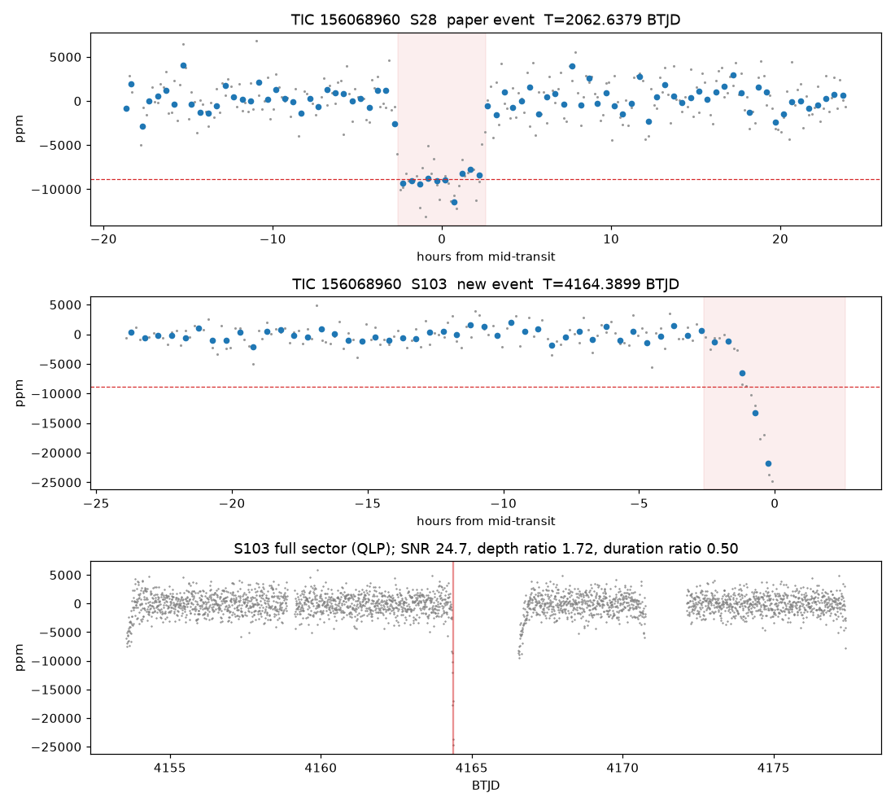

## TIC 267000676 (paper T1 2071.8807, new T2 3874.7737, S94 QLP)
Depth 7042 +/- 298 ppm vs 5343 ppm; duration 6.80 h vs 3.82 h (box fits; paper CNN: 5890 ppm, 7.64 h); SNR 23.6. dT = 1802.89 d, so P <= 1802.89 d. Aliases: 30 allowed, 1771 excluded by data, 0 below the circular-orbit minimum (6.2 d). Longest allowed 1802.89 d. Possible third transit at P = 54.6331 d.
Notes: only 61% of the transit window has data; also passes: S94 T=3874.8334 SNR 20.0, depth ratio 1.28, duration ratio 1.26 (66% covered); also passes: S68 T=3164.5295 SNR 18.7, depth ratio 1.08, duration ratio 1.59
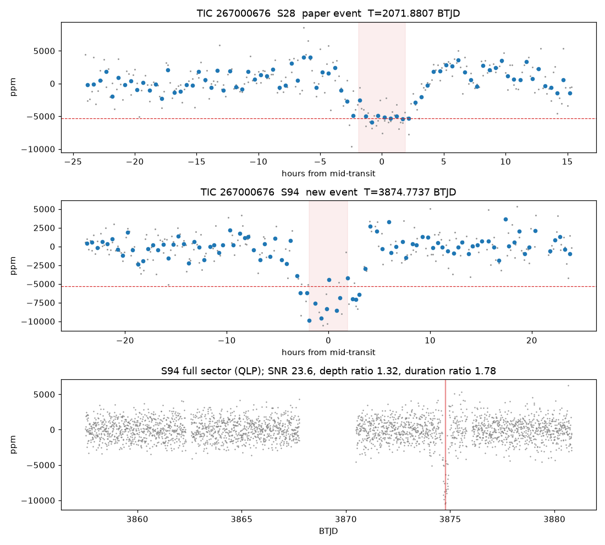

## TIC 300164137 (paper T1 2077.4681, new T2 3995.1885, S98 QLP)
Depth 2937 +/- 145 ppm vs 1978 ppm; duration 19.79 h vs 11.11 h (box fits; paper CNN: 2782 ppm, 12.47 h); SNR 20.3. dT = 1917.72 d, so P <= 1917.72 d. Aliases: 3 allowed, 1914 excluded by data, 0 below the circular-orbit minimum (32.6 d). Longest allowed 1917.72 d.
Notes: event 0.05 d from a gap or sector edge, check systematics; only 54% of the transit window has data; also passes: S89 T=3732.8218 SNR 14.4, depth ratio 1.22, duration ratio 1.59 (64% covered); also passes: S96 T=3933.0006 SNR 12.5, depth ratio 0.78, duration ratio 2.00 (near edge, 51% covered); also passes: S94 T=3874.9621 SNR 12.0, depth ratio 0.79, duration ratio 1.78 (56% covered); also passes: S87 T=3676.2412 SNR 10.4, depth ratio 1.32, duration ratio 0.63 (near edge); also passes: S61 T=2971.4170 SNR 10.3, depth ratio 0.94, duration ratio 0.89; also passes: S87 T=3666.1880 SNR 9.5, depth ratio 1.21, duration ratio 0.63; also passes: S63 T=3021.0774 SNR 9.2, depth ratio 0.87, duration ratio 1.12 (72% covered); also passes: S97 T=3980.1950 SNR 9.1, depth ratio 0.69, duration ratio 1.00 (near edge); also passes: S94 T=3864.7238 SNR 9.0, depth ratio 1.06, duration ratio 0.50; also passes: S87 T=3664.1057 SNR 9.0, depth ratio 1.16, duration ratio 0.63 (near edge); also passes: S65 T=3070.7056 SNR 8.9, depth ratio 0.89, duration ratio 1.00; also passes: S68 T=3170.0478 SNR 8.6, depth ratio 0.96, duration ratio 0.63; also passes: S62 T=2989.8739 SNR 8.5, depth ratio 1.09, duration ratio 0.56; also passes: S88 T=3715.8754 SNR 8.2, depth ratio 0.79, duration ratio 0.89; also passes: S63 T=3014.4948 SNR 7.9, depth ratio 0.77, duration ratio 1.12 (near edge, 68% covered); also passes: S88 T=3703.8439 SNR 7.3, depth ratio 0.94, duration ratio 0.89 (57% covered); also passes: S96 T=3914.1436 SNR 7.3, depth ratio 0.64, duration ratio 0.89 (59% covered)
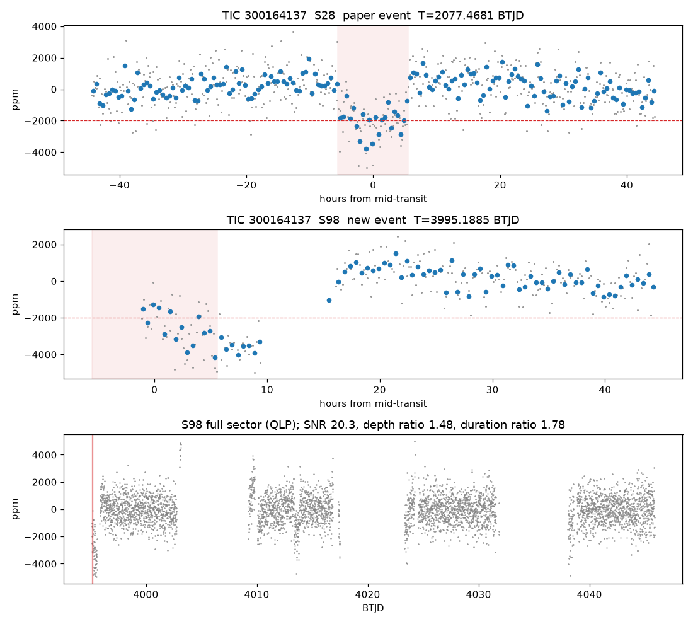

## TIC 107113048 (paper T1 2312.9442, new T2 4102.1982, S101 QLP)
Depth 5697 +/- 283 ppm vs 6688 ppm; duration 5.96 h vs 6.69 h (box fits; paper CNN: 8227 ppm, 7.51 h); SNR 20.1. dT = 1789.25 d, so P <= 1789.25 d. Aliases: 25 allowed, 1760 excluded by data, 0 below the circular-orbit minimum (36.1 d). Longest allowed 1789.25 d. Possible third transit at P = 149.1045;74.5523;49.7015;29.8209 d.
Notes: event 0.40 d from a gap or sector edge, check systematics; also passes: S90 T=3754.2911 SNR 17.8, depth ratio 1.01, duration ratio 1.00; also passes: S64 T=3058.4708 SNR 14.3, depth ratio 0.97, duration ratio 0.89
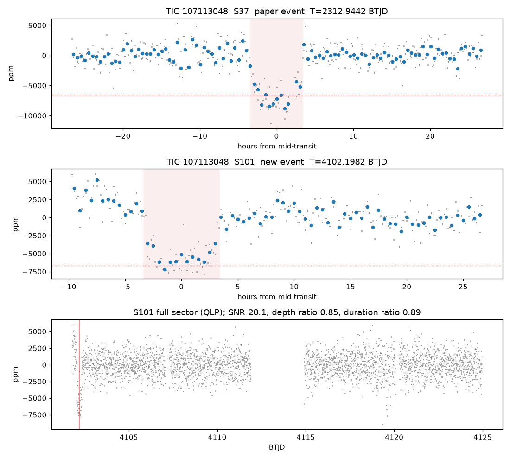

## TIC 32287672 (paper T1 2701.1354, new T2 3790.7758, S91 QLP)
Depth 5557 +/- 299 ppm vs 5369 ppm; duration 3.07 h vs 3.45 h (box fits; paper CNN: 6275 ppm, 3.87 h); SNR 18.6. dT = 1089.64 d, so P <= 1089.64 d. Aliases: 66 allowed, 1023 excluded by data, 0 below the circular-orbit minimum (5.7 d). Longest allowed 1089.64 d.
Notes: none flagged.
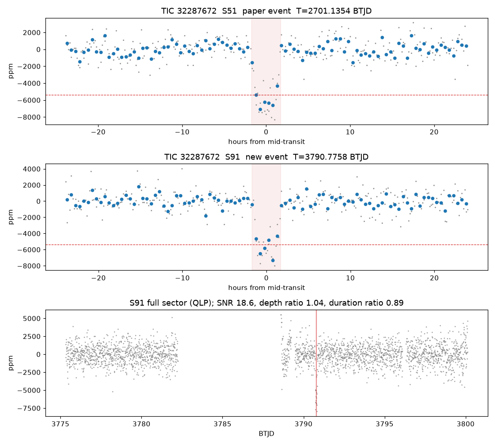

## TIC 38584656 (paper T1 2287.4708, new T2 4002.5186, S98 QLP)
Depth 1335 +/- 75 ppm vs 976 ppm; duration 12.65 h vs 7.10 h (box fits; paper CNN: 1347 ppm, 7.10 h); SNR 17.9. dT = 1715.05 d, so P <= 1715.05 d. Aliases: 2 allowed, 1713 excluded by data, 0 below the circular-orbit minimum (14.3 d). Longest allowed 1715.05 d.
Notes: event 0.26 d from a gap or sector edge, check systematics; also passes: S97 T=3980.1915 SNR 15.2, depth ratio 1.37, duration ratio 1.59 (near edge, 74% covered); also passes: S97 T=3980.1028 SNR 14.3, depth ratio 1.08, duration ratio 2.00 (near edge); also passes: S96 T=3932.9520 SNR 11.5, depth ratio 0.95, duration ratio 2.00 (near edge, 68% covered); also passes: S94 T=3874.7503 SNR 10.4, depth ratio 1.00, duration ratio 1.26 (76% covered); also passes: S97 T=3987.4216 SNR 9.2, depth ratio 0.68, duration ratio 2.00; also passes: S95 T=3899.7249 SNR 8.0, depth ratio 0.84, duration ratio 1.41 (near edge, 55% covered); also passes: S64 T=3058.2468 SNR 7.5, depth ratio 0.78, duration ratio 1.00
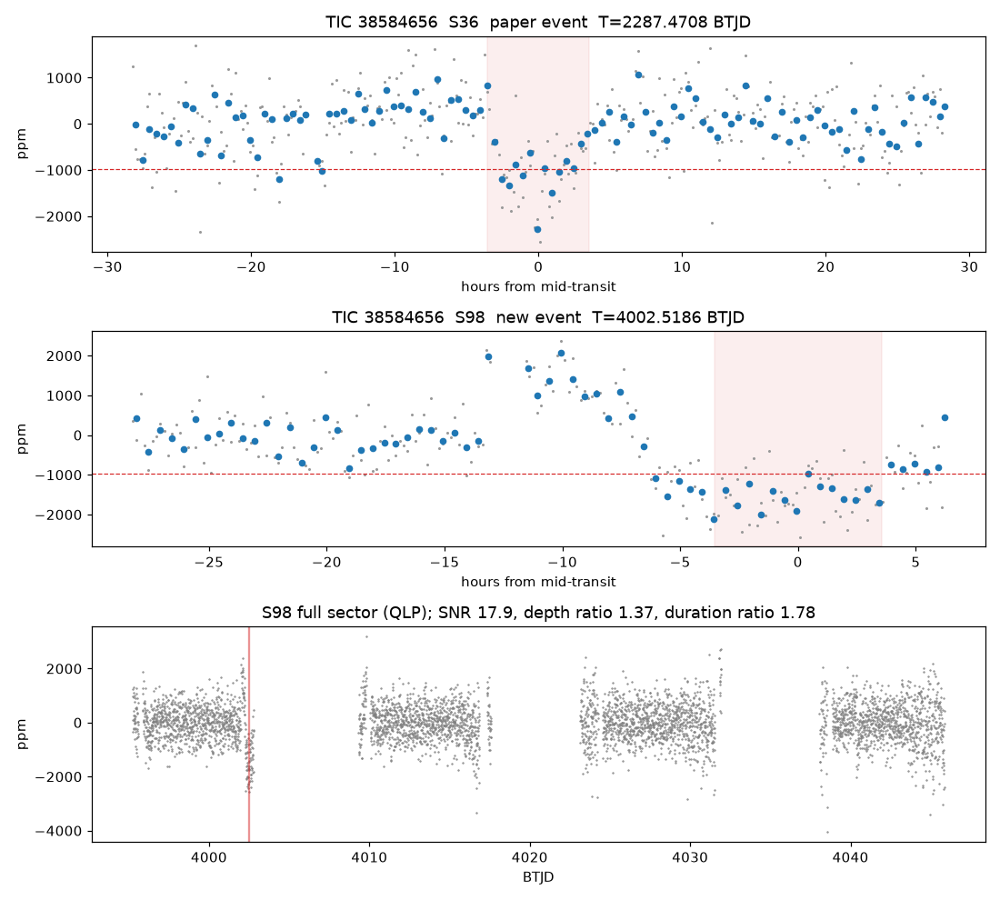

## TIC 382302456 (paper T1 2234.3742, new T2 3874.8121, S94 QLP)
Depth 1823 +/- 115 ppm vs 1150 ppm; duration 12.02 h vs 12.02 h (box fits; paper CNN: 1551 ppm, 13.49 h); SNR 15.9. dT = 1640.44 d, so P <= 1640.44 d. Aliases: 3 allowed, 1637 excluded by data, 0 below the circular-orbit minimum (83.3 d). Longest allowed 1640.44 d.
Notes: only 72% of the transit window has data; also passes: S98 T=3995.4490 SNR 15.7, depth ratio 1.80, duration ratio 1.00 (near edge, 79% covered); also passes: S97 T=3973.9418 SNR 12.2, depth ratio 1.69, duration ratio 0.63 (near edge); also passes: S69 T=3182.5555 SNR 10.6, depth ratio 1.09, duration ratio 1.12 (near edge, 59% covered); also passes: S97 T=3967.3207 SNR 10.2, depth ratio 1.90, duration ratio 0.63 (55% covered); also passes: S88 T=3690.2305 SNR 10.2, depth ratio 1.01, duration ratio 1.78 (near edge, 56% covered); also passes: S97 T=3959.9612 SNR 9.5, depth ratio 1.04, duration ratio 1.78 (near edge, 79% covered); also passes: S94 T=3875.6882 SNR 8.5, depth ratio 0.96, duration ratio 1.00 (55% covered); also passes: S96 T=3914.6802 SNR 7.6, depth ratio 0.64, duration ratio 1.12; also passes: S89 T=3732.9128 SNR 7.1, depth ratio 1.10, duration ratio 0.79 (51% covered)
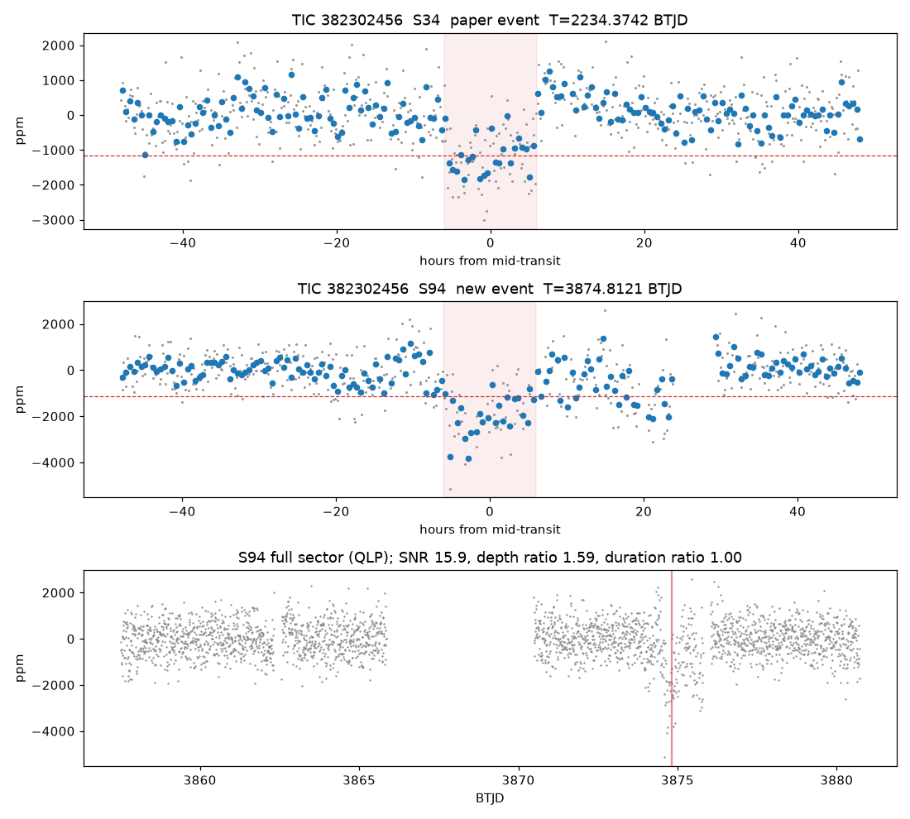

## TIC 234605163 (paper T1 2209.5170, new T2 3672.5065, S87 QLP)
Depth 5742 +/- 366 ppm vs 6790 ppm; duration 6.99 h vs 7.85 h (box fits; paper CNN: 7494 ppm, 8.81 h); SNR 15.7. dT = 1462.99 d, so P <= 1462.99 d. Aliases: 35 allowed, 1381 excluded by data, 46 below the circular-orbit minimum (41.2 d). Longest allowed 1462.99 d.
Notes: none flagged.
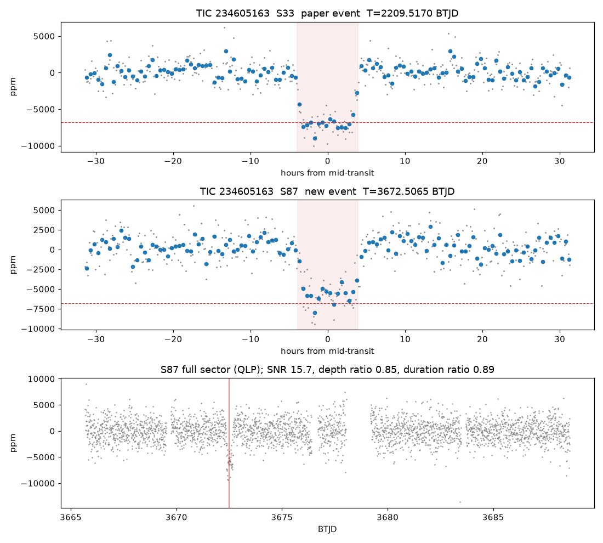

## TIC 40001645 (paper T1 2465.7276, new T2 3820.5784, S92 SPOC)
Depth 6366 +/- 417 ppm vs 6129 ppm; duration 4.28 h vs 4.28 h (box fits; paper CNN: 6812 ppm, 6.05 h); SNR 15.3. dT = 1354.85 d, so P <= 1354.85 d. Aliases: 77 allowed, 1276 excluded by data, 0 below the circular-orbit minimum (2.7 d). Longest allowed 1354.85 d. Possible third transit at P = 11.9898 d.
Notes: also passes: S92 T=3808.5921 SNR 15.2, depth ratio 0.97, duration ratio 1.26
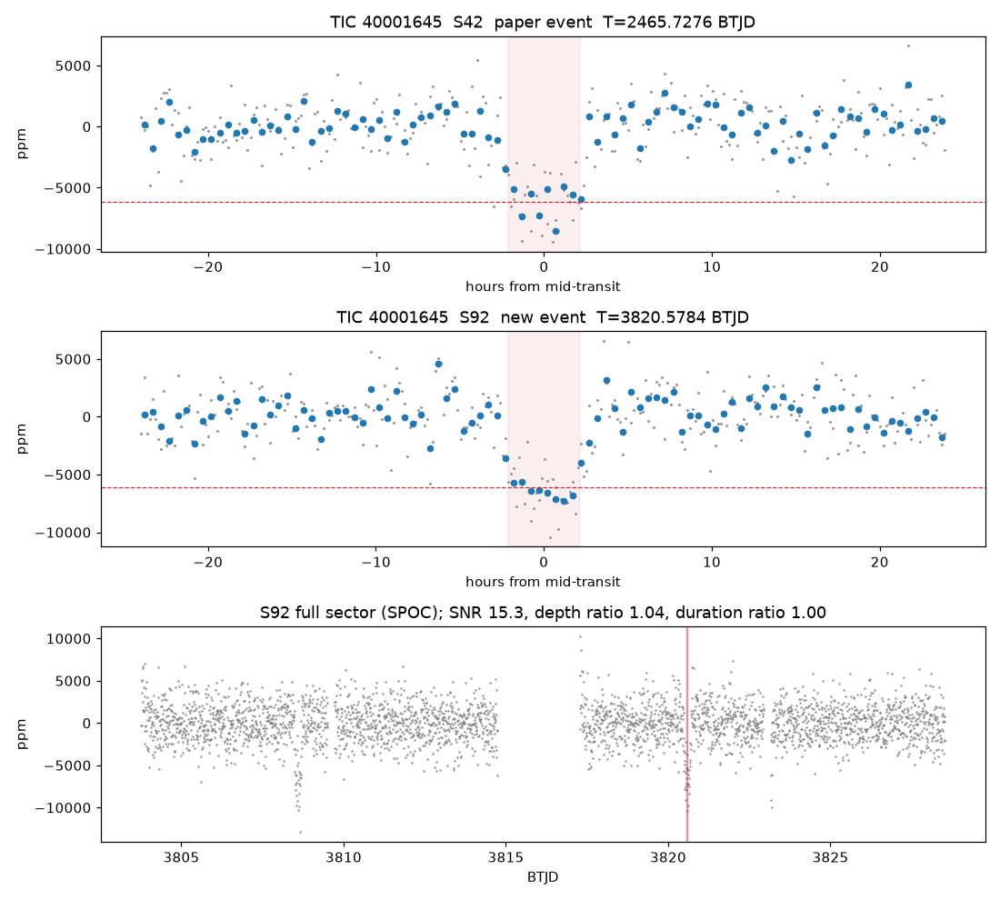

## TIC 265466589 (paper T1 2037.8672, new T2 3865.3857, S94 SPOC)
Depth 6407 +/- 434 ppm vs 6418 ppm; duration 4.29 h vs 3.03 h (box fits; paper CNN: 6570 ppm, 4.82 h); SNR 14.8. dT = 1827.52 d, so P <= 1827.52 d. Aliases: 10 allowed, 1815 excluded by data, 0 below the circular-orbit minimum (3.5 d). Longest allowed 1827.52 d. Possible third transit at P = 65.2685;32.6343 d.
Notes: already CTOI 265466589.01 (P=); also passes: S95 T=3898.0193 SNR 11.9, depth ratio 1.02, duration ratio 0.89; also passes: S67 T=3147.4447 SNR 8.2, depth ratio 0.87, duration ratio 1.59
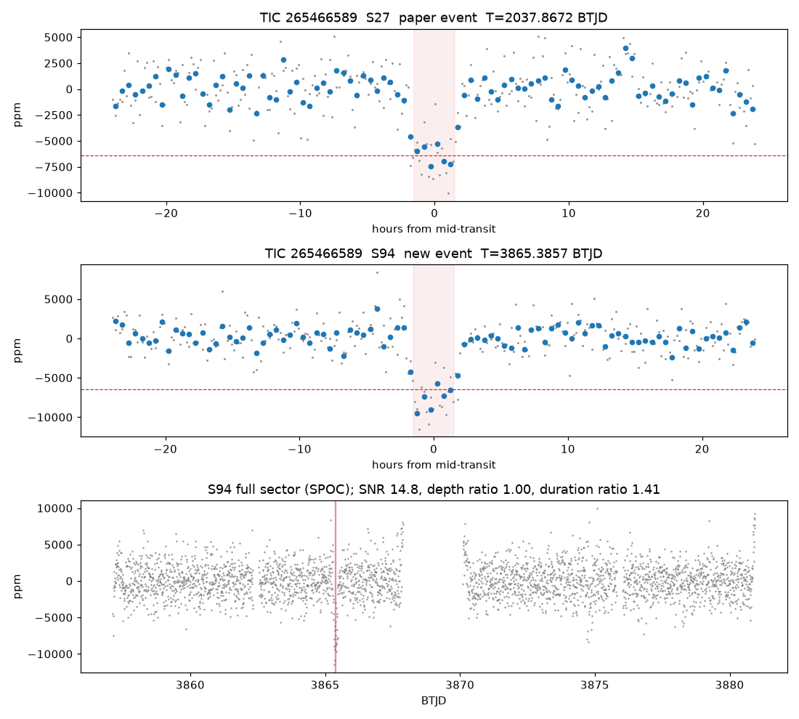

## TIC 56815340 (paper T1 2569.3836, new T2 3790.6493, S91 SPOC)
Depth 874 +/- 62 ppm vs 767 ppm; duration 3.55 h vs 5.63 h (box fits; paper CNN: 970 ppm, 5.02 h); SNR 14.1. dT = 1221.27 d, so P <= 1221.27 d. Aliases: 63 allowed, 1145 excluded by data, 13 below the circular-orbit minimum (19.1 d). Longest allowed 1221.27 d.
Notes: already TOI 7513.01;7513.02 (P=9.5803;1221.2710, same signal: no;yes, disp KP;KP); also passes: S91 T=3798.9782 SNR 10.5, depth ratio 0.89, duration ratio 0.63 (near edge)
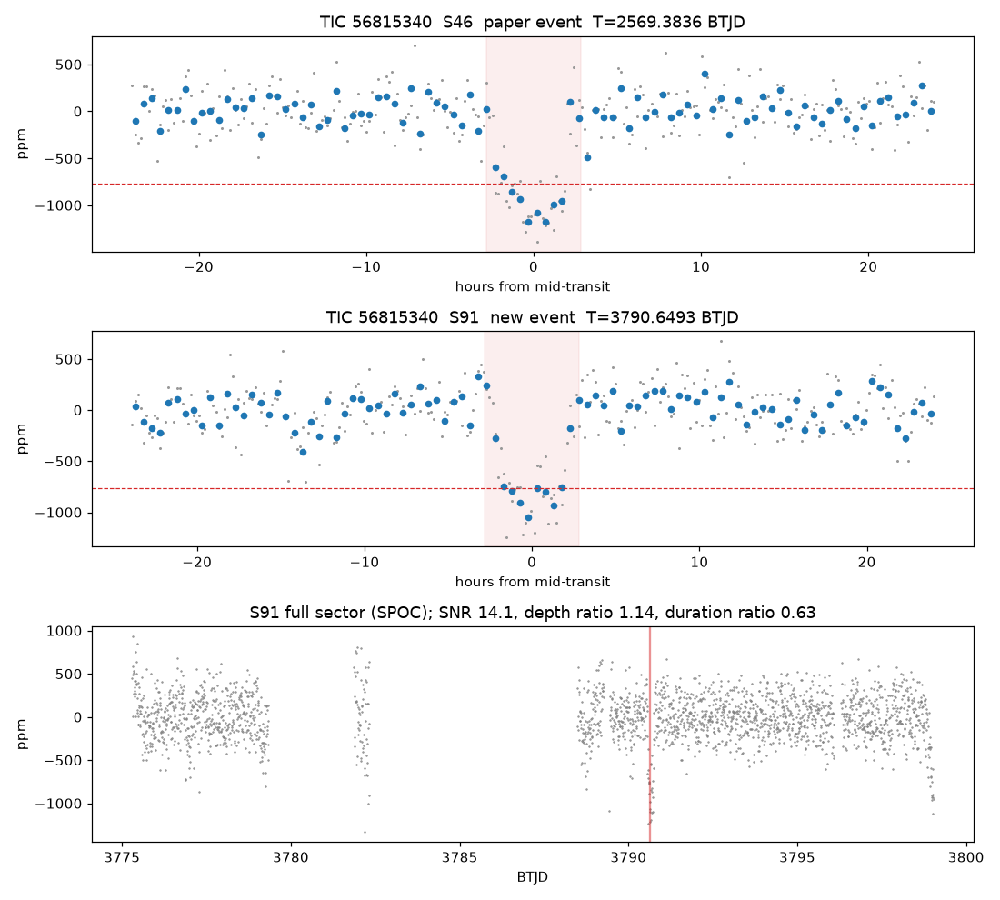

## TIC 274858362 (paper T1 2798.3994, new T2 3550.3915, S82 TESS-SPOC)
Depth 2459 +/- 177 ppm vs 3199 ppm; duration 6.10 h vs 4.84 h (box fits; paper CNN: 3611 ppm, 6.10 h); SNR 13.9. dT = 751.99 d, so P <= 751.99 d. Aliases: 35 allowed, 715 excluded by data, 0 below the circular-orbit minimum (2.9 d). Longest allowed 751.99 d. Possible third transit at P = 10.5914 d.
Notes: also passes: S82 T=3539.8004 SNR 13.0, depth ratio 0.71, duration ratio 1.26
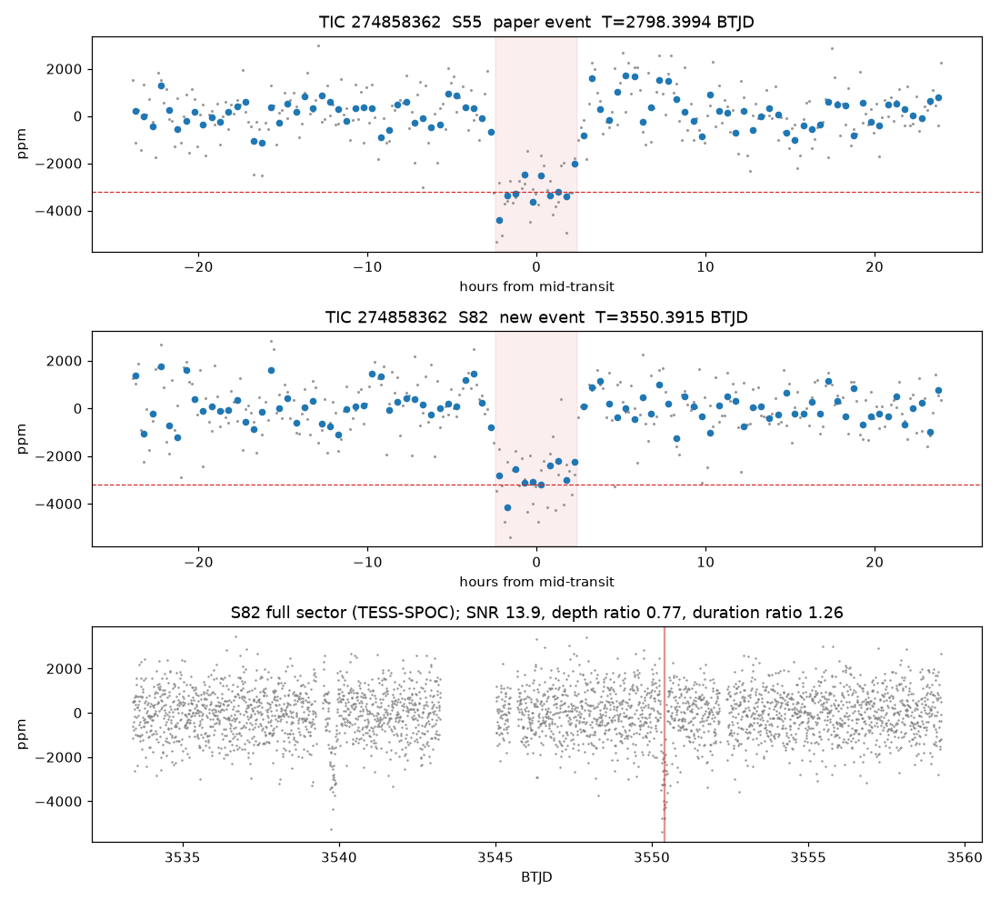

## TIC 229155120 (paper T1 2105.8182, new T2 3980.3062, S97 QLP)
Depth 2472 +/- 180 ppm vs 2095 ppm; duration 5.28 h vs 2.64 h (box fits; paper CNN: 2467 ppm, 3.33 h); SNR 13.8. dT = 1874.49 d, so P <= 1874.49 d. Aliases: 22 allowed, 1852 excluded by data, 0 below the circular-orbit minimum (1.6 d). Longest allowed 1874.49 d.
Notes: already TOI 7874.01 (P=29.5380, same signal: yes, disp PC); event 0.11 d from a gap or sector edge, check systematics; also passes: S97 T=3980.2100 SNR 11.2, depth ratio 0.92, duration ratio 2.00 (near edge); also passes: S69 T=3198.7252 SNR 10.8, depth ratio 1.13, duration ratio 1.12; also passes: S97 T=3966.7179 SNR 10.0, depth ratio 1.07, duration ratio 1.00
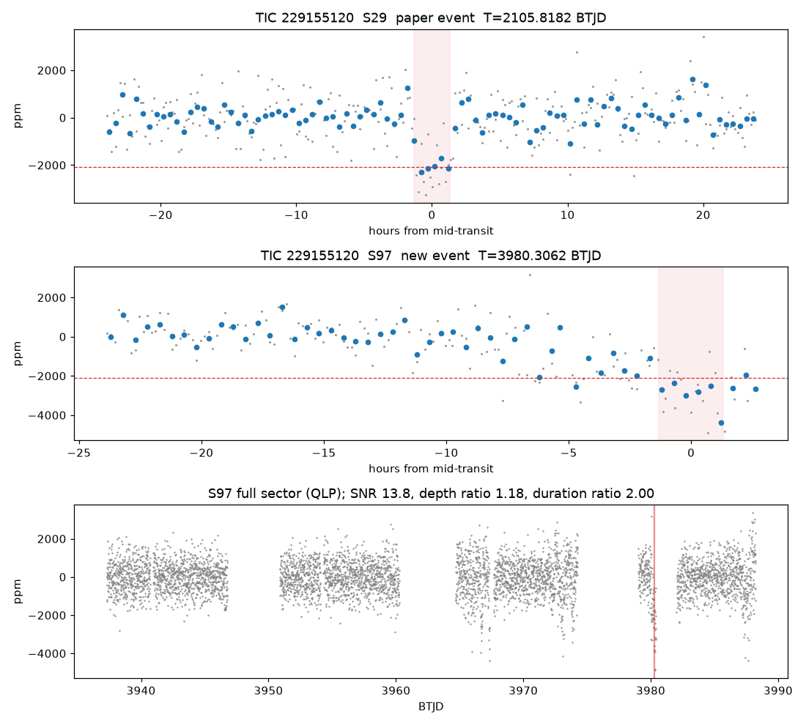

## TIC 150324787 (paper T1 2260.7770, new T2 3987.4132, S97 QLP)
Depth 778 +/- 58 ppm vs 571 ppm; duration 9.75 h vs 9.75 h (box fits; paper CNN: 747 ppm, 12.28 h); SNR 13.5. dT = 1726.64 d, so P <= 1726.64 d. Aliases: 3 allowed, 1723 excluded by data, 0 below the circular-orbit minimum (49.7 d). Longest allowed 1726.64 d.
Notes: also passes: S62 T=3013.9475 SNR 12.5, depth ratio 1.92, duration ratio 0.50 (near edge, 58% covered); also passes: S95 T=3896.3397 SNR 10.8, depth ratio 1.53, duration ratio 0.56 (near edge, 61% covered)
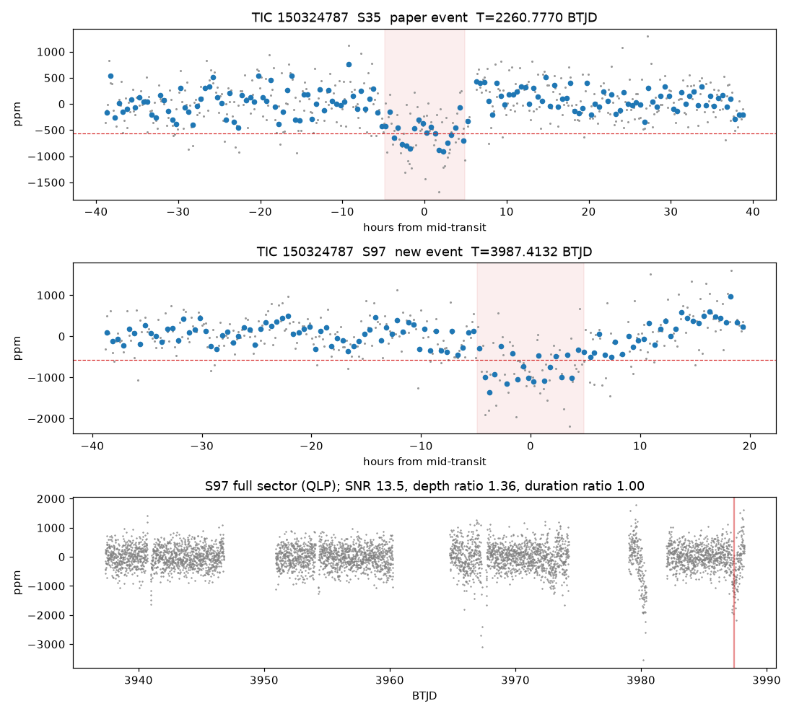

## TIC 299746836 (paper T1 2043.3880, new T2 3856.4736, S94 QLP)
Depth 5207 +/- 388 ppm vs 4277 ppm; duration 2.64 h vs 4.19 h (box fits; paper CNN: 4680 ppm, 5.28 h); SNR 13.4. dT = 1813.09 d, so P <= 1813.09 d. Aliases: 44 allowed, 1768 excluded by data, 1 below the circular-orbit minimum (23.6 d). Longest allowed 1813.09 d.
Notes: event 0.02 d from a gap or sector edge, check systematics; only 69% of the transit window has data; also passes: S94 T=3869.6120 SNR 13.3, depth ratio 0.69, duration ratio 1.41 (near edge)
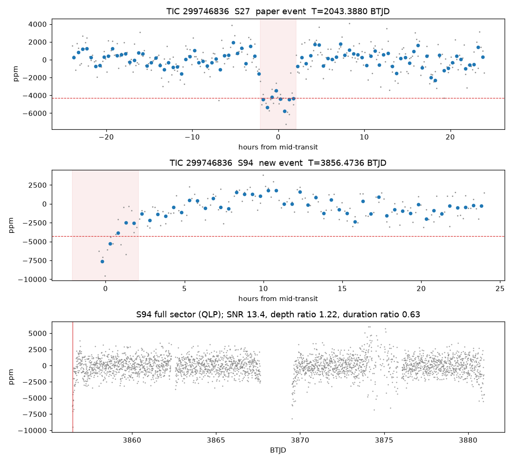

## TIC 347472067 (paper T1 2465.6325, new T2 3217.6608, S70 TESS-SPOC)
Depth 6663 +/- 517 ppm vs 5291 ppm; duration 3.32 h vs 3.72 h (box fits; paper CNN: 5633 ppm, 5.26 h); SNR 12.9. dT = 752.03 d, so P <= 752.03 d. Aliases: 19 allowed, 733 excluded by data, 0 below the circular-orbit minimum (8.8 d). Longest allowed 752.03 d.
Notes: none flagged.
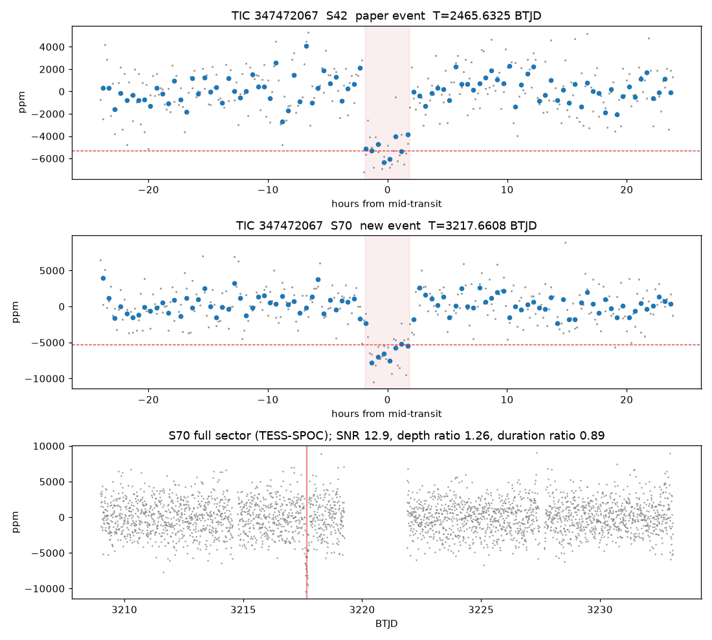

## TIC 141682338 (paper T1 2247.9532, new T2 2987.8606, S61 QLP)
Depth 4278 +/- 334 ppm vs 2757 ppm; duration 6.68 h vs 4.72 h (box fits; paper CNN: 3437 ppm, 5.95 h); SNR 12.8. dT = 739.91 d, so P <= 739.91 d. Aliases: 0 allowed, 739 excluded by data, 0 below the circular-orbit minimum (5.1 d). Longest allowed nan d.
Notes: event 0.02 d from a gap or sector edge, check systematics; only 60% of the transit window has data; also passes: S61 T=2975.0600 SNR 11.8, depth ratio 1.43, duration ratio 1.59 (near edge, 53% covered); also passes: S95 T=3891.0973 SNR 10.2, depth ratio 0.70, duration ratio 1.26; also passes: S63 T=3015.0146 SNR 7.3, depth ratio 0.91, duration ratio 0.79
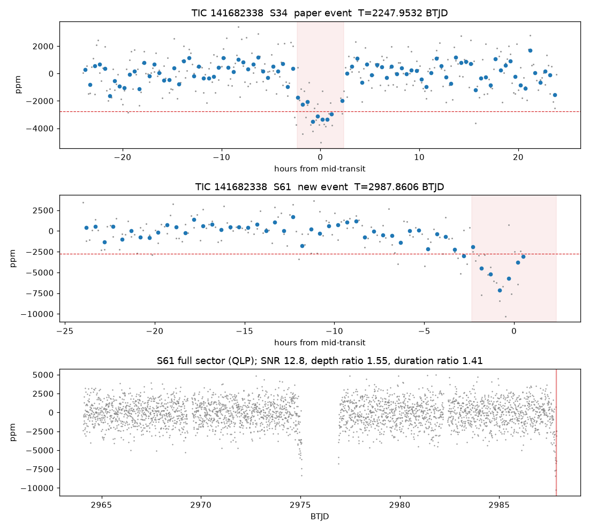

## TIC 271796731 (paper T1 2220.3437, new T2 3980.2195, S97 QLP)
Depth 814 +/- 64 ppm vs 573 ppm; duration 13.19 h vs 6.60 h (box fits; paper CNN: 768 ppm, 7.41 h); SNR 12.7. dT = 1759.88 d, so P <= 1759.88 d. Aliases: 2 allowed, 1757 excluded by data, 0 below the circular-orbit minimum (33.7 d). Longest allowed 1759.88 d.
Notes: event 0.17 d from a gap or sector edge, check systematics; only 62% of the transit window has data; also passes: S95 T=3899.6292 SNR 12.0, depth ratio 1.58, duration ratio 1.12 (near edge); also passes: S97 T=3980.1301 SNR 11.7, depth ratio 1.17, duration ratio 2.00 (near edge, 78% covered); also passes: S96 T=3932.7411 SNR 11.6, depth ratio 1.14, duration ratio 1.41 (near edge); also passes: S98 T=3995.9850 SNR 10.4, depth ratio 1.15, duration ratio 1.41; also passes: S98 T=4038.4470 SNR 10.3, depth ratio 1.48, duration ratio 1.00 (near edge, 71% covered); also passes: S96 T=3926.0409 SNR 10.1, depth ratio 0.99, duration ratio 1.41; also passes: S64 T=3053.3657 SNR 8.7, depth ratio 1.11, duration ratio 1.00; also passes: S95 T=3886.3388 SNR 8.6, depth ratio 1.33, duration ratio 0.71; also passes: S89 T=3739.9226 SNR 7.7, depth ratio 1.96, duration ratio 0.56 (near edge, 54% covered); also passes: S94 T=3874.0787 SNR 7.7, depth ratio 1.24, duration ratio 0.63
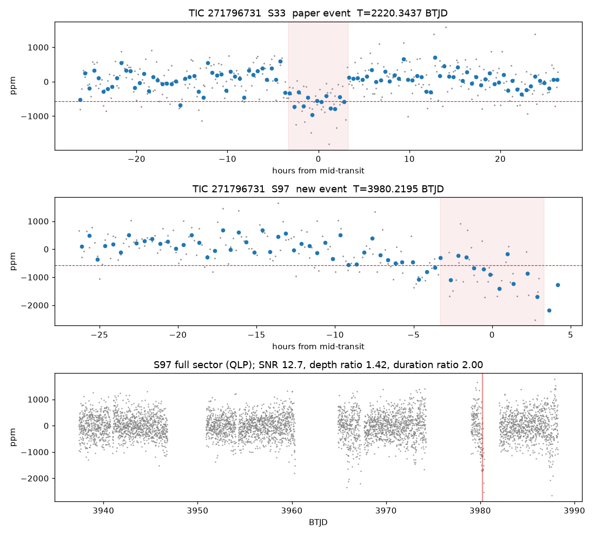

## TIC 284188366 (paper T1 2435.6026, new T2 3506.0481, S80 QLP)
Depth 4731 +/- 376 ppm vs 2757 ppm; duration 7.33 h vs 6.53 h (box fits; paper CNN: 3455 ppm, 7.33 h); SNR 12.6. dT = 1070.45 d, so P <= 1070.45 d. Aliases: 7 allowed, 1063 excluded by data, 0 below the circular-orbit minimum (5.9 d). Longest allowed 1070.45 d.
Notes: event 0.26 d from a gap or sector edge, check systematics; also passes: S79 T=3473.4510 SNR 7.1, depth ratio 1.17, duration ratio 0.89
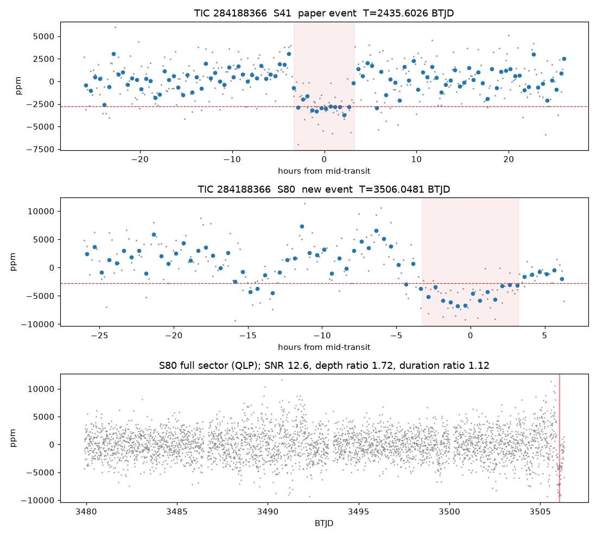

## TIC 302377820 (paper T1 2064.7829, new T2 3899.7784, S95 QLP)
Depth 1264 +/- 101 ppm vs 1107 ppm; duration 8.69 h vs 5.47 h (box fits; paper CNN: 1419 ppm, 6.14 h); SNR 12.6. dT = 1835.00 d, so P <= 1835.00 d. Aliases: 47 allowed, 1780 excluded by data, 7 below the circular-orbit minimum (28.8 d). Longest allowed 1835.00 d.
Notes: already CTOI 302377820.01 (P=6.7537); paper already reports a transit in S68 matching candidate b; event 0.15 d from a gap or sector edge, check systematics; only 54% of the transit window has data; also passes: S95 T=3890.1694 SNR 10.2, depth ratio 0.85, duration ratio 1.00; also passes: S68 T=3171.9994 SNR 9.0, depth ratio 1.05, duration ratio 0.79; also passes: S95 T=3893.1519 SNR 8.4, depth ratio 0.79, duration ratio 0.79
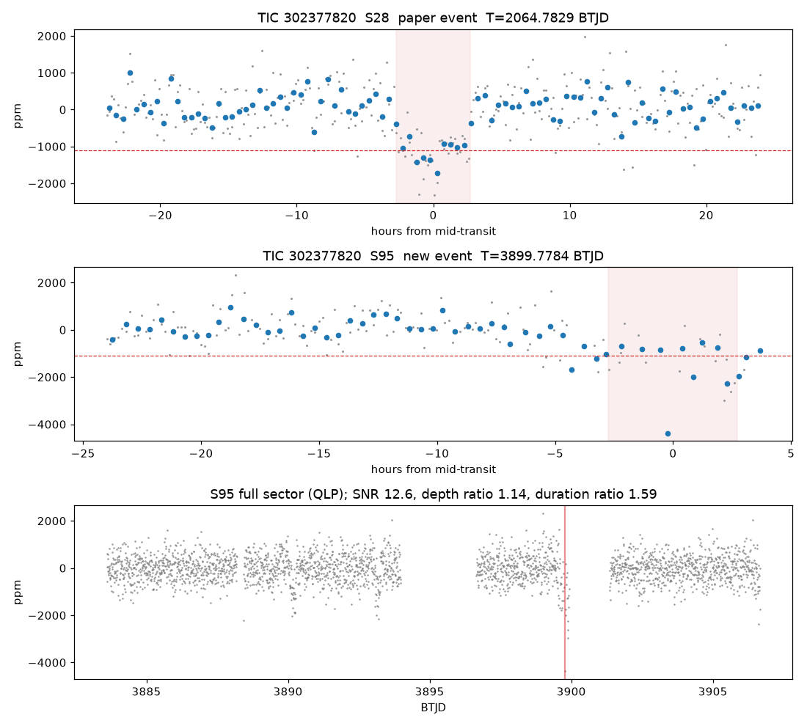

## TIC 302377820 (paper T1 2071.0595, new T2 3899.7510, S95 QLP)
Depth 1283 +/- 104 ppm vs 950 ppm; duration 7.34 h vs 3.67 h (box fits; paper CNN: 1255 ppm, 6.54 h); SNR 12.3. dT = 1828.69 d, so P <= 1828.69 d. Aliases: 62 allowed, 1765 excluded by data, 0 below the circular-orbit minimum (8.7 d). Longest allowed 1828.69 d. Possible third transit at P = 18.6601 d.
Notes: already CTOI 302377820.01 (P=6.7537); paper already reports a transit in S68 matching candidate b; event 0.18 d from a gap or sector edge, check systematics; only 59% of the transit window has data; also passes: S95 T=3890.2049 SNR 10.1, depth ratio 1.26, duration ratio 0.89; also passes: S95 T=3893.1842 SNR 8.2, depth ratio 1.03, duration ratio 0.89; also passes: S68 T=3171.9936 SNR 8.1, depth ratio 1.17, duration ratio 1.26
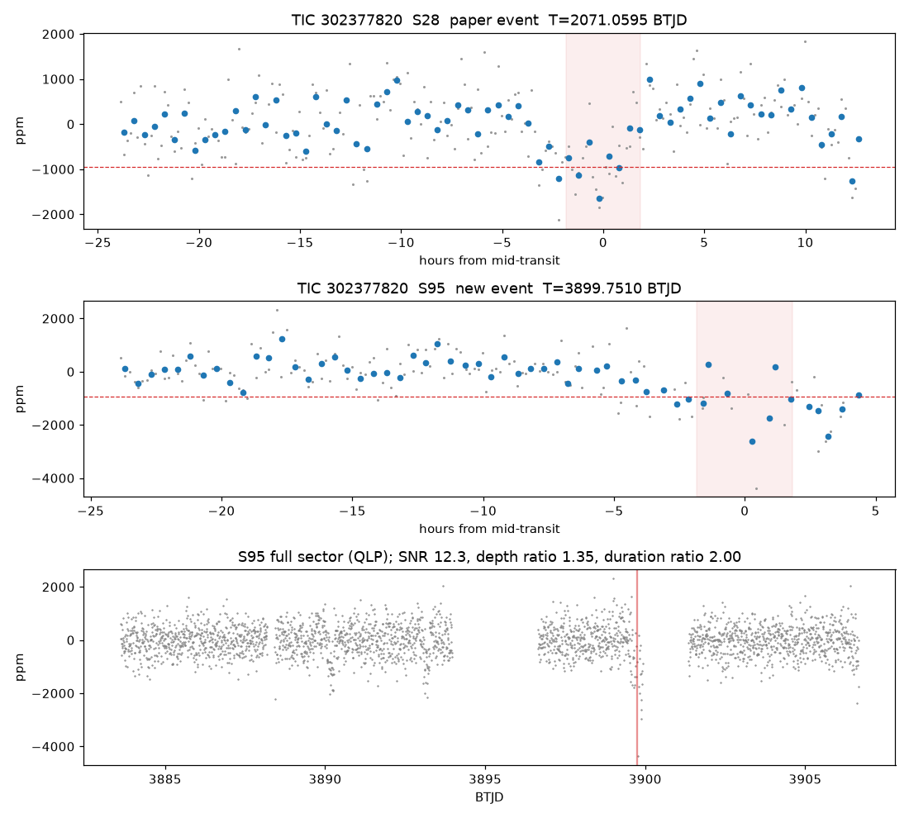

## TIC 53849826 (paper T1 2068.4638, new T2 3899.7784, S95 QLP)
Depth 1710 +/- 143 ppm vs 3090 ppm; duration 5.22 h vs 2.93 h (box fits; paper CNN: 3185 ppm, 4.14 h); SNR 11.9. dT = 1831.31 d, so P <= 1831.31 d. Aliases: 59 allowed, 1772 excluded by data, 0 below the circular-orbit minimum (7.2 d). Longest allowed 1831.31 d.
Notes: event 0.15 d from a gap or sector edge, check systematics; only 61% of the transit window has data; also passes: S95 T=3899.7632 SNR 10.7, depth ratio 0.51, duration ratio 1.78 (near edge, 58% covered)
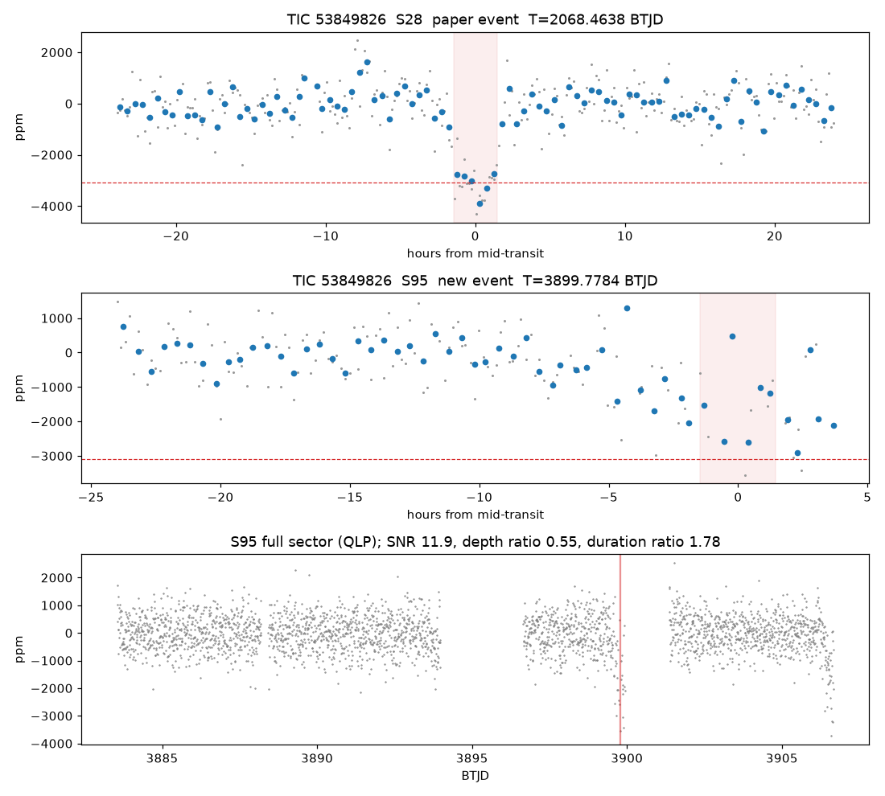

## TIC 198009543 (paper T1 2162.3365, new T2 3919.4310, S96 QLP)
Depth 3233 +/- 277 ppm vs 4377 ppm; duration 8.63 h vs 9.69 h (box fits; paper CNN: 5729 ppm, 10.88 h); SNR 11.7. dT = 1757.09 d, so P <= 1757.09 d. Aliases: 11 allowed, 1745 excluded by data, 0 below the circular-orbit minimum (42.8 d). Longest allowed 1757.09 d. Possible third transit at P = 117.1396 d.
Notes: also passes: S89 T=3743.7093 SNR 9.0, depth ratio 0.80, duration ratio 1.12; also passes: S97 T=3954.4349 SNR 7.6, depth ratio 0.57, duration ratio 1.59 (69% covered); also passes: S68 T=3158.0393 SNR 7.3, depth ratio 1.06, duration ratio 0.71
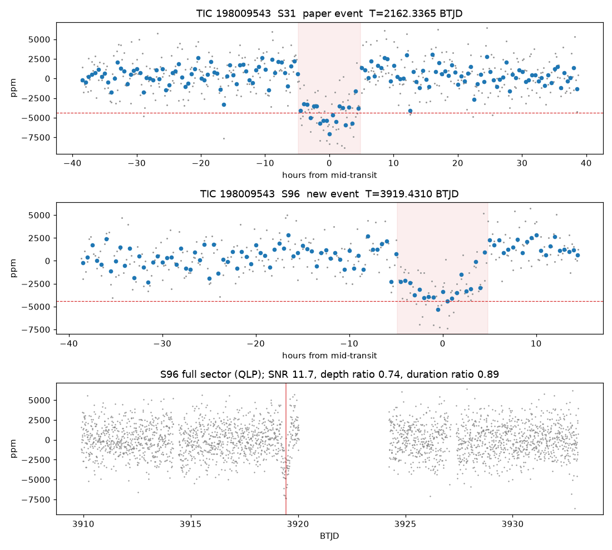

## TIC 269130683 (paper T1 2436.5563, new T2 3322.4038, S74 QLP)
Depth 2794 +/- 243 ppm vs 4005 ppm; duration 4.77 h vs 2.68 h (box fits; paper CNN: 4000 ppm, 5.36 h); SNR 11.5. dT = 885.85 d, so P <= 885.85 d. Aliases: 6 allowed, 878 excluded by data, 0 below the circular-orbit minimum (0.9 d). Longest allowed 885.85 d. Possible third transit at P = 49.2138 d.
Notes: already TOI 7263.01 (P=49.2145, same signal: yes, disp PC); also passes: S81 T=3520.2980 SNR 11.1, depth ratio 0.84, duration ratio 1.26 (near edge); also passes: S75 T=3357.4057 SNR 9.8, depth ratio 1.00, duration ratio 0.89; also passes: S74 T=3322.4597 SNR 9.1, depth ratio 0.55, duration ratio 1.78
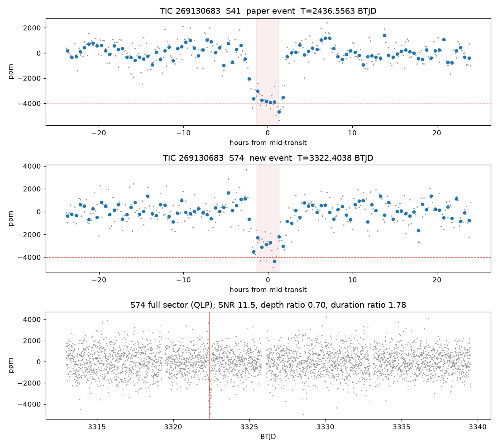

## TIC 278991817 (paper T1 2079.9807, new T2 3877.2516, S94 QLP)
Depth 2398 +/- 226 ppm vs 3647 ppm; duration 6.61 h vs 4.68 h (box fits; paper CNN: 3863 ppm, 7.42 h); SNR 10.6. dT = 1797.27 d, so P <= 1797.27 d. Aliases: 2 allowed, 1792 excluded by data, 0 below the circular-orbit minimum (0.4 d). Longest allowed 1797.27 d. Possible third transit at P = 898.6355;449.3177;224.6589 d.
Notes: also passes: S98 T=4023.1299 SNR 8.9, depth ratio 0.57, duration ratio 2.00 (near edge, 62% covered); also passes: S61 T=2978.6197 SNR 8.6, depth ratio 0.75, duration ratio 1.41; also passes: S69 T=3203.2732 SNR 8.3, depth ratio 0.77, duration ratio 1.41; also passes: S65 T=3090.9518 SNR 8.1, depth ratio 0.79, duration ratio 1.59
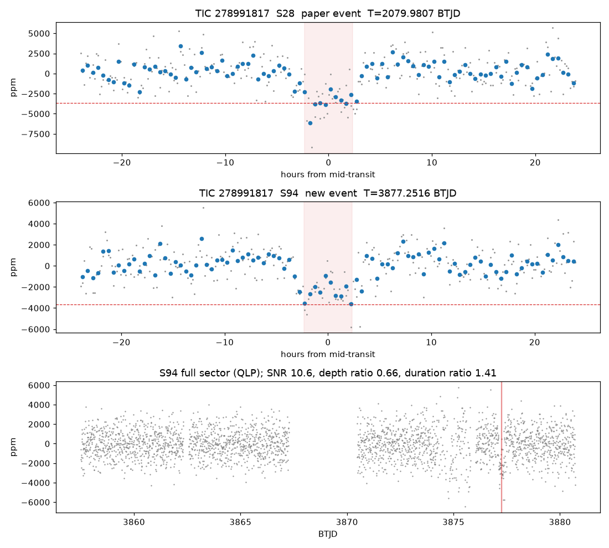

## TIC 336891168 (paper T1 2488.1725, new T2 3222.9162, S70 TESS-SPOC)
Depth 4494 +/- 427 ppm vs 3047 ppm; duration 2.57 h vs 4.58 h (box fits; paper CNN: 4047 ppm, 6.47 h); SNR 10.5. dT = 734.74 d, so P <= 734.74 d. Aliases: 30 allowed, 704 excluded by data, 0 below the circular-orbit minimum (5.6 d). Longest allowed 734.74 d.
Notes: none flagged.
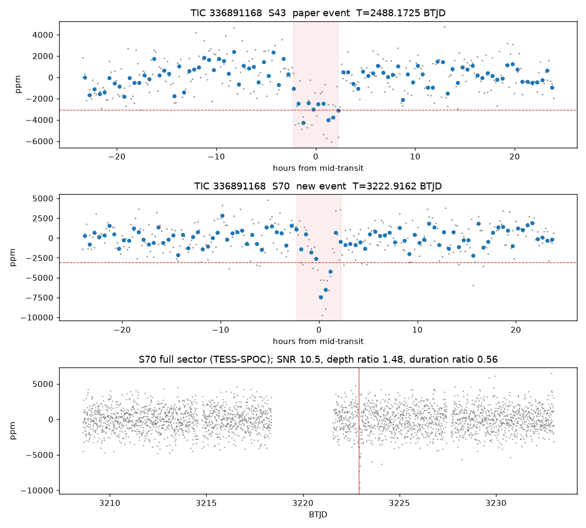

## TIC 279727635 (paper T1 2124.6269, new T2 3910.6921, S96 SPOC)
Depth 4749 +/- 473 ppm vs 5519 ppm; duration 2.88 h vs 3.63 h (box fits; paper CNN: 6038 ppm, 5.14 h); SNR 10.0. dT = 1786.07 d, so P <= 1786.07 d. Aliases: 14 allowed, 1772 excluded by data, 0 below the circular-orbit minimum (5.9 d). Longest allowed 1786.07 d.
Notes: already CTOI 279727635.01 (P=)
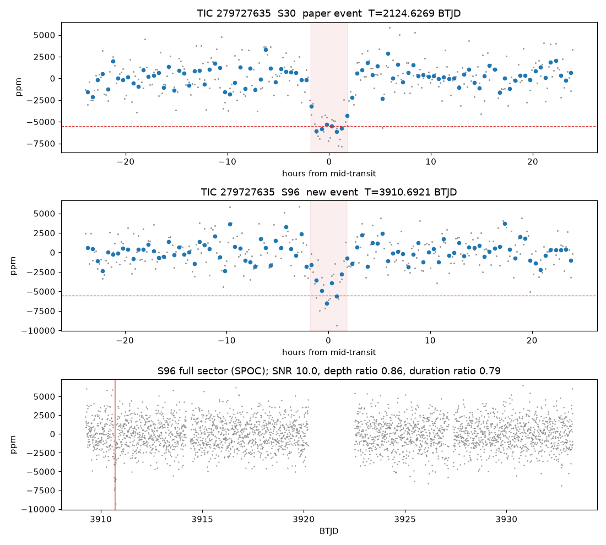

## TIC 365208001 (paper T1 2465.4105, new T2 3245.2674, S71 TESS-SPOC)
Depth 2702 +/- 271 ppm vs 2860 ppm; duration 4.78 h vs 5.37 h (box fits; paper CNN: 3316 ppm, 6.76 h); SNR 10.0. dT = 779.86 d, so P <= 779.86 d. Aliases: 21 allowed, 758 excluded by data, 0 below the circular-orbit minimum (10.0 d). Longest allowed 779.86 d.
Notes: also passes: S71 T=3235.4348 SNR 8.1, depth ratio 1.14, duration ratio 0.79 (near edge, 51% covered); also passes: S70 T=3227.1631 SNR 7.1, depth ratio 0.68, duration ratio 1.00
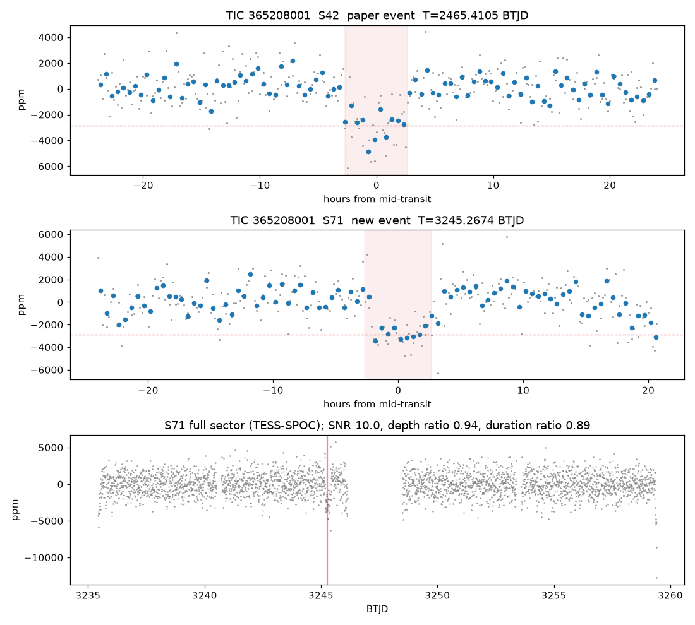

## TIC 32486691 (paper T1 2039.8056, new T2 3140.6674, S67 QLP)
Depth 8349 +/- 859 ppm vs 6856 ppm; duration 2.60 h vs 4.13 h (box fits; paper CNN: 7753 ppm, 5.85 h); SNR 9.7. dT = 1100.86 d, so P <= 1100.86 d. Aliases: 41 allowed, 1059 excluded by data, 0 below the circular-orbit minimum (3.5 d). Longest allowed 1100.86 d.
Notes: event 0.15 d from a gap or sector edge, check systematics
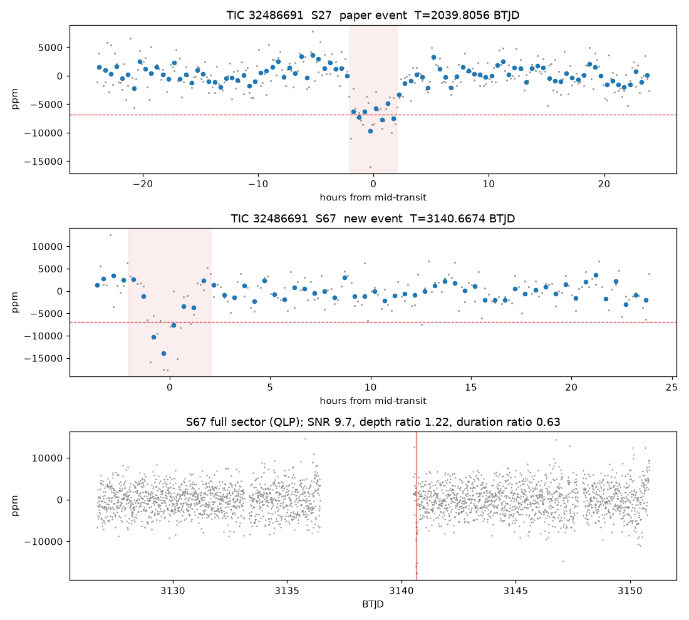

## TIC 441460039 (paper T1 2040.7236, new T2 3896.7041, S95 QLP)
Depth 1269 +/- 132 ppm vs 1628 ppm; duration 15.96 h vs 7.98 h (box fits; paper CNN: 2148 ppm, 8.96 h); SNR 9.6. dT = 1855.98 d, so P <= 1855.98 d. Aliases: 50 allowed, 1805 excluded by data, 0 below the circular-orbit minimum (12.2 d). Longest allowed 1855.98 d.
Notes: event 0.05 d from a gap or sector edge, check systematics; only 58% of the transit window has data
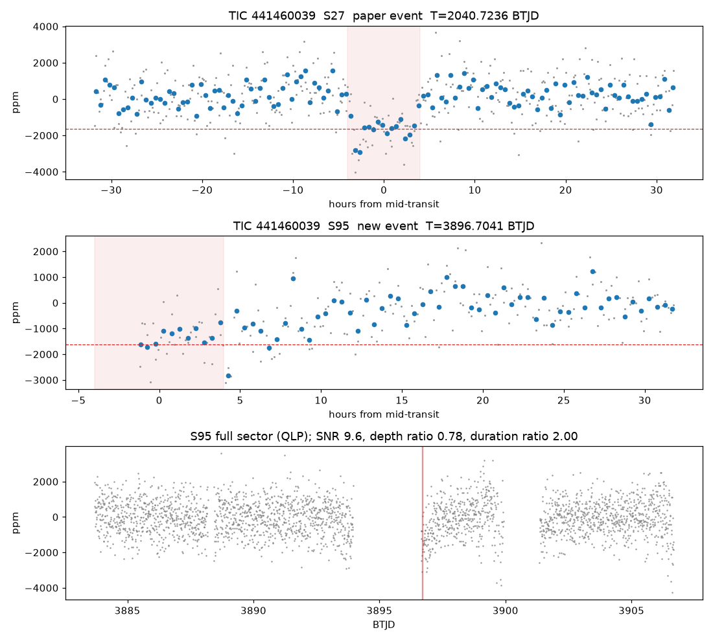

## TIC 454039549 (paper T1 2310.6779, new T2 4109.0420, S101 QLP)
Depth 1697 +/- 180 ppm vs 2039 ppm; duration 6.61 h vs 6.61 h (box fits; paper CNN: 2516 ppm, 9.35 h); SNR 9.4. dT = 1798.36 d, so P <= 1798.36 d. Aliases: 14 allowed, 1782 excluded by data, 0 below the circular-orbit minimum (4.4 d). Longest allowed 1798.36 d. Possible third transit at P = 43.8625;21.9313 d.
Notes: already TOI 7743.01 (P=10.9655, same signal: yes, disp PC); also passes: S100 T=4076.1126 SNR 9.1, depth ratio 0.81, duration ratio 1.12; also passes: S90 T=3758.1199 SNR 8.7, depth ratio 0.89, duration ratio 1.12; also passes: S99 T=4065.1871 SNR 8.4, depth ratio 0.67, duration ratio 1.12; also passes: S101 T=4119.8384 SNR 8.4, depth ratio 1.21, duration ratio 0.63 (60% covered); also passes: S90 T=3769.0679 SNR 8.2, depth ratio 0.79, duration ratio 1.26; also passes: S64 T=3067.2973 SNR 7.7, depth ratio 0.98, duration ratio 1.12 (near edge); also passes: S99 T=4054.1840 SNR 7.6, depth ratio 0.60, duration ratio 1.12; also passes: S100 T=4098.0292 SNR 7.4, depth ratio 0.74, duration ratio 0.89 (near edge)
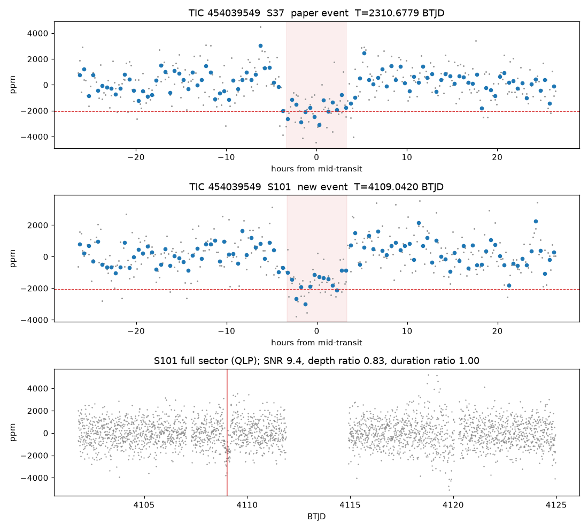

## TIC 404736082 (paper T1 2492.0463, new T2 3254.4223, S71 TESS-SPOC)
Depth 1691 +/- 181 ppm vs 1211 ppm; duration 3.43 h vs 4.32 h (box fits; paper CNN: 1781 ppm, 4.32 h); SNR 9.4. dT = 762.38 d, so P <= 762.38 d. Aliases: 18 allowed, 743 excluded by data, 0 below the circular-orbit minimum (15.8 d). Longest allowed 762.38 d. Possible third transit at P = 31.7657 d.
Notes: already CTOI 404736082.01 (P=8.9279); paper mentions further transits in S70, association unclear; also passes: S71 T=3250.3401 SNR 8.6, depth ratio 1.53, duration ratio 0.63; also passes: S70 T=3222.6648 SNR 8.3, depth ratio 1.16, duration ratio 0.89; also passes: S71 T=3241.4294 SNR 8.2, depth ratio 1.44, duration ratio 0.63; also passes: S70 T=3232.4837 SNR 7.4, depth ratio 1.04, duration ratio 0.89
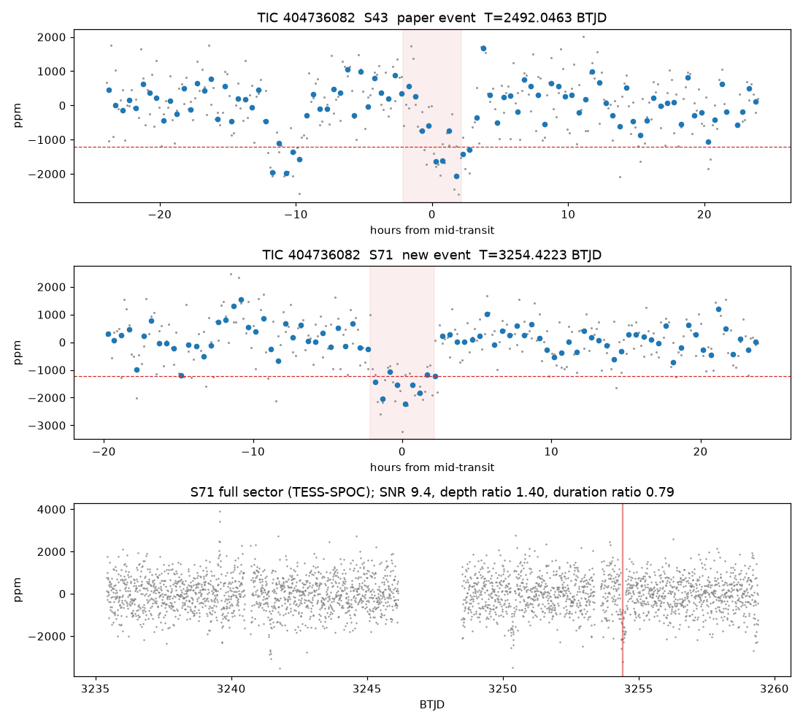

## TIC 44926986 (paper T1 2303.9047, new T2 3003.2203, S62 TESS-SPOC)
Depth 771 +/- 88 ppm vs 867 ppm; duration 4.08 h vs 2.88 h (box fits; paper CNN: 1077 ppm, 3.63 h); SNR 8.7. dT = 699.32 d, so P <= 699.32 d. Aliases: 7 allowed, 691 excluded by data, 0 below the circular-orbit minimum (2.4 d). Longest allowed 699.32 d. Possible third transit at P = 24.1143 d.
Notes: event 0.47 d from a gap or sector edge, check systematics; also passes: S89 T=3726.6905 SNR 8.1, depth ratio 0.78, duration ratio 1.41
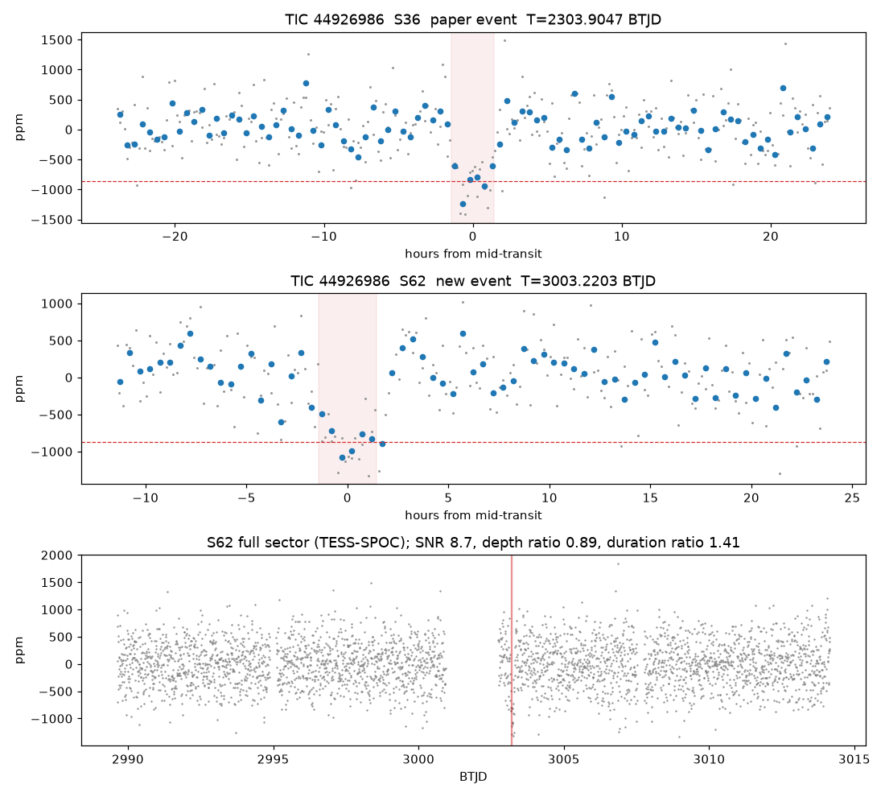

## TIC 99673203 (paper T1 2069.5685, new T2 3899.8021, S95 QLP)
Depth 2989 +/- 342 ppm vs 5880 ppm; duration 7.52 h vs 3.76 h (box fits; paper CNN: 6704 ppm, 4.22 h); SNR 8.7. dT = 1830.23 d, so P <= 1830.23 d. Aliases: 34 allowed, 1796 excluded by data, 0 below the circular-orbit minimum (9.8 d). Longest allowed 1830.23 d.
Notes: event 0.13 d from a gap or sector edge, check systematics; only 55% of the transit window has data
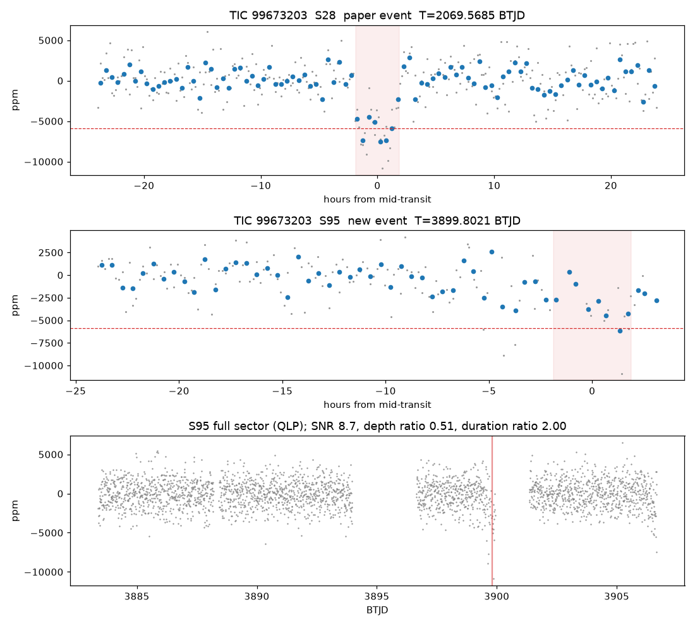

## TIC 139470998 (paper T1 2126.0331, new T2 3987.4619, S97 QLP)
Depth 1997 +/- 230 ppm vs 1459 ppm; duration 10.95 h vs 19.51 h (box fits; paper CNN: 2629 ppm, 10.95 h); SNR 8.7. dT = 1861.43 d, so P <= 1861.43 d. Aliases: 3 allowed, 1827 excluded by data, 30 below the circular-orbit minimum (520.6 d). Longest allowed 1861.43 d. Possible third transit at P = 33.8442 d.
Notes: already CTOI 139470998.01 (P=121.8000)
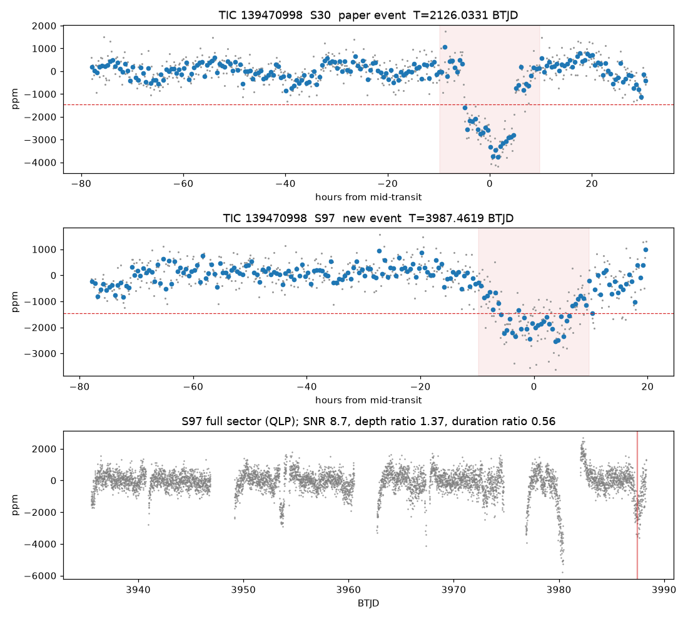

## TIC 283607560 (paper T1 2184.2512, new T2 4061.8839, S1751 TESS-SPOC)
Depth 1021 +/- 119 ppm vs 667 ppm; duration 4.25 h vs 4.78 h (box fits; paper CNN: 816 ppm, 5.36 h); SNR 8.6. dT = 1877.63 d, so P <= 1877.63 d. Aliases: 14 allowed, 1862 excluded by data, 0 below the circular-orbit minimum (0.4 d). Longest allowed 1877.63 d. Possible third transit at P = 56.8980 d.
Notes: event 0.02 d from a gap or sector edge, check systematics; only 67% of the transit window has data
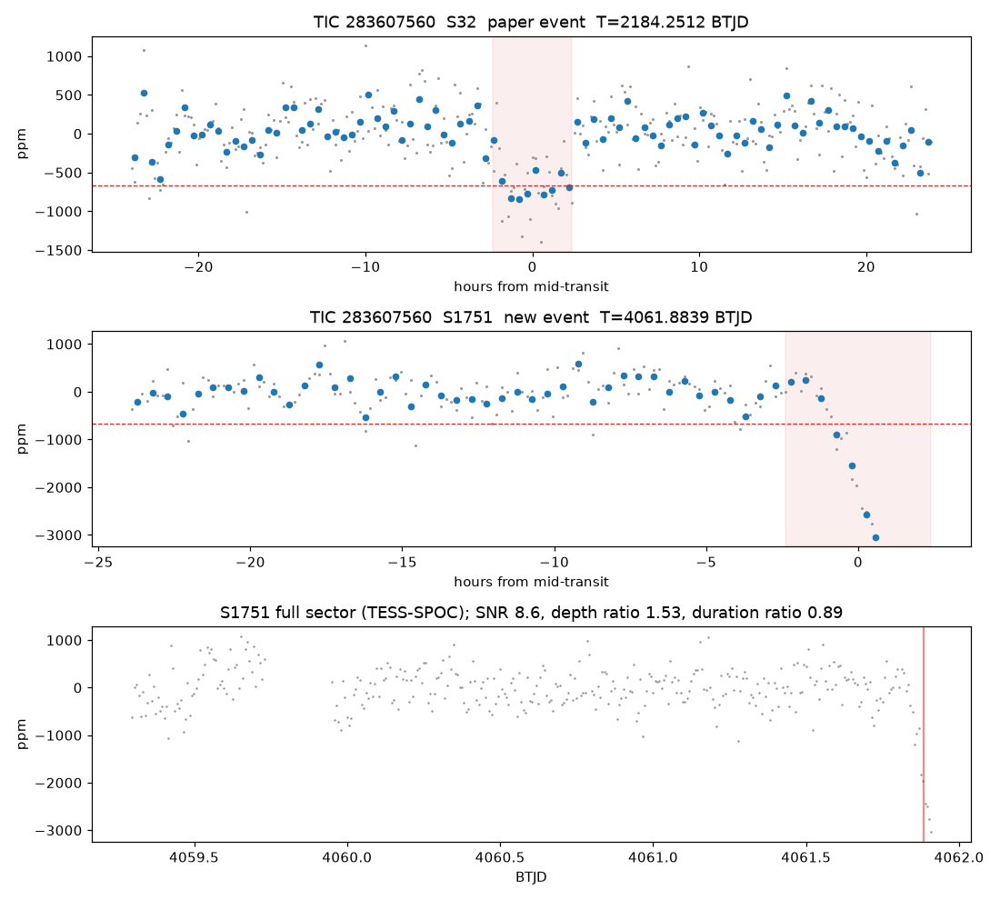

## TIC 404736082 (paper T1 2491.6070, new T2 3222.6844, S70 TESS-SPOC)
Depth 1548 +/- 185 ppm vs 1537 ppm; duration 3.08 h vs 2.74 h (box fits; paper CNN: 2231 ppm, 3.45 h); SNR 8.4. dT = 731.08 d, so P <= 731.08 d. Aliases: 16 allowed, 714 excluded by data, 0 below the circular-orbit minimum (4.0 d). Longest allowed 731.08 d. Possible third transit at P = 31.7860 d.
Notes: already CTOI 404736082.01 (P=8.9279); paper mentions further transits in S70, association unclear; also passes: S70 T=3232.4937 SNR 8.3, depth ratio 0.97, duration ratio 1.12
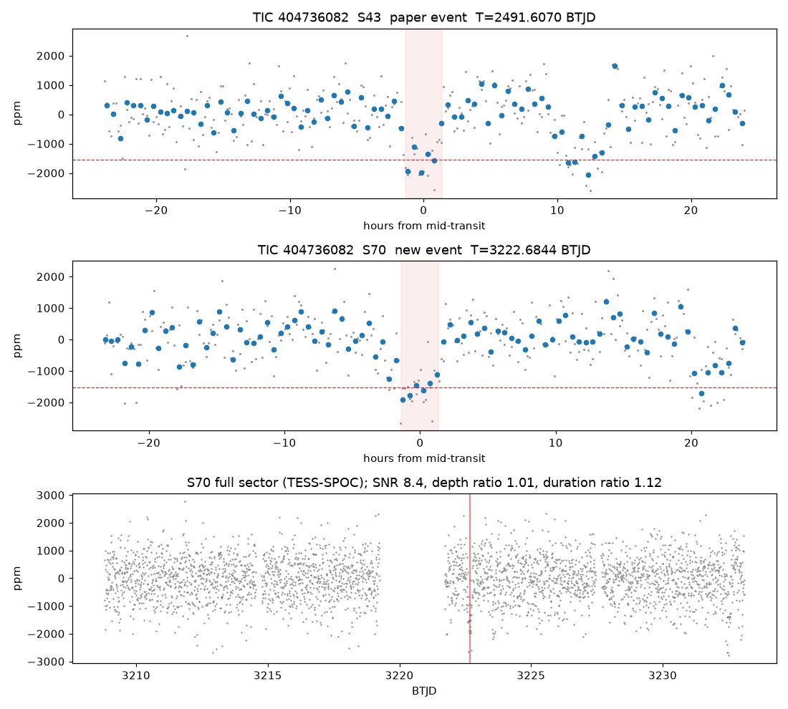

## TIC 397483270 (paper T1 2642.4955, new T2 3285.5236, S72 SPOC)
Depth 690 +/- 88 ppm vs 1146 ppm; duration 4.69 h vs 5.27 h (box fits; paper CNN: 1080 ppm, 6.64 h); SNR 7.9. dT = 643.03 d, so P <= 643.03 d. Aliases: 13 allowed, 630 excluded by data, 0 below the circular-orbit minimum (13.3 d). Longest allowed 643.03 d.
Notes: already CTOI 397483270.01 (P=); event 0.04 d from a gap or sector edge, check systematics; only 75% of the transit window has data

## TIC 302461481 (paper T1 2465.1270, new T2 3239.5803, S71 TESS-SPOC)
Depth 755 +/- 97 ppm vs 623 ppm; duration 6.93 h vs 13.87 h (box fits; paper CNN: 930 ppm, 13.87 h); SNR 7.8. dT = 774.45 d, so P <= 774.45 d. Aliases: 15 allowed, 759 excluded by data, 0 below the circular-orbit minimum (32.5 d). Longest allowed 774.45 d.
Notes: none flagged.

## TIC 96582891 (paper T1 2232.5628, new T2 3668.9365, S87 QLP)
Depth 2790 +/- 365 ppm vs 2629 ppm; duration 3.94 h vs 3.94 h (box fits; paper CNN: 3270 ppm, 4.96 h); SNR 7.7. dT = 1436.37 d, so P <= 1436.37 d. Aliases: 46 allowed, 1389 excluded by data, 0 below the circular-orbit minimum (0.3 d). Longest allowed 1436.37 d. Possible third transit at P = 22.0981 d.
Notes: none flagged.

## TIC 195665214 (paper T1 2802.6032, new T2 3365.4706, S75 TESS-SPOC)
Depth 455 +/- 61 ppm vs 423 ppm; duration 4.53 h vs 5.08 h (box fits; paper CNN: 585 ppm, 5.08 h); SNR 7.5. dT = 562.87 d, so P <= 562.87 d. Aliases: 6 allowed, 554 excluded by data, 0 below the circular-orbit minimum (17.4 d). Longest allowed 562.87 d. Possible third transit at P = 56.2867;28.1434 d.
Notes: none flagged.

## TIC 157226444 (paper T1 2289.3865, new T2 3035.6640, S63 TESS-SPOC)
Depth 1280 +/- 179 ppm vs 1151 ppm; duration 4.41 h vs 3.50 h (box fits; paper CNN: 1232 ppm, 5.55 h); SNR 7.1. dT = 746.28 d, so P <= 746.28 d. Aliases: 15 allowed, 730 excluded by data, 0 below the circular-orbit minimum (8.7 d). Longest allowed 746.28 d. Possible third transit at P = 20.7299 d.
Notes: none flagged.

## TIC 155657159 (paper T1 2408.8112, new T2 3293.8102, S73 TESS-SPOC)
Depth 1421 +/- 203 ppm vs 1787 ppm; duration 3.68 h vs 6.56 h (box fits; paper CNN: 2065 ppm, 8.27 h); SNR 7.0. dT = 885.00 d, so P <= 885.00 d. Aliases: 6 allowed, 878 excluded by data, 0 below the circular-orbit minimum (15.0 d). Longest allowed 885.00 d.
Notes: none flagged.

